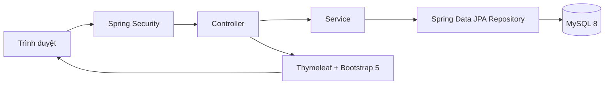
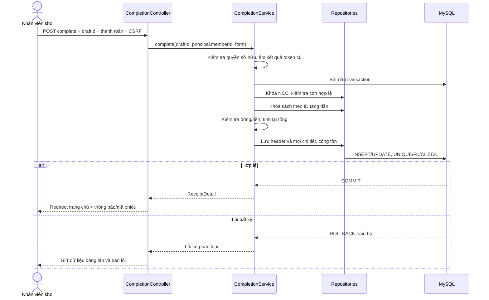

# Kiến trúc Library Management System — Module 03

**Trạng thái:** Đã cập nhật theo quyết định phê duyệt chính thức (ngày 05/11/2026). Đọc cùng [requirements.md](requirements.md) (toàn bộ câu hỏi Q00–Q17 đã được phê duyệt dứt khoát). Chưa tạo application code.

## 1. Phương án và quyết định đã phê duyệt

| Phương án | Lợi ích | Đánh đổi | Trạng thái |
|---|---|---|---|
| A. Spring MVC theo tầng, giữ mô hình kế thừa và 11 bảng báo cáo | Đối chiếu chặt chẽ với bài phân tích; đáp ứng Thymeleaf; một ứng dụng/một DB; bảo toàn quan hệ kế thừa | Kế thừa JPA nhiều bảng; hồ sơ NCC không có credential đăng nhập, bổ sung tên tổ chức | **ĐÃ PHÊ DUYỆT CHÍNH THỨC (Q03)** |
| B. MVC theo tầng, tách tài khoản và hồ sơ NCC | Auth và doanh nghiệp độc lập | Thay đổi quan hệ kế thừa và lược đồ báo cáo | **HỦY BỎ** (Đã chọn Phương án A) |

Các quyết định nghiệp vụ và kỹ thuật chính thức đã phê duyệt:
- **Q01:** Chỉ triển khai hai actor nội bộ (`ROLE_WAREHOUSE`, `ROLE_MANAGER`); không triển khai cổng NCC tự phục vụ.
- **Q02:** **Không CRUD nhà cung cấp độc lập; chỉ làm sâu chức năng tra cứu, xem danh sách và xem chi tiết chỉ đọc** theo đúng báo cáo trang 12–13 và ảnh 48–49. Nhánh tạo nhanh NCC chỉ nằm trong luồng nhập sách (UC01) khi nhập từ NCC chưa có trong hệ thống.
- **Q06:** **Không cần danh mục trả thiếu / đủ / đơn giá 0, tiền lẻ**. Tiền tệ VND nguyên (không tiền lẻ thập phân); đơn giá bắt buộc $> 0$ (không chấp nhận đơn giá 0); số lượng nguyên $> 0$; ghi nhận thông tin phương thức thanh toán và số tiền đã thanh toán trực tiếp trên phiếu, không quản lý công nợ.
- **Q07 & Q08:** Điều hướng thuận tiện: tạo NCC trong luồng nhập xong tự động chọn và mở phiếu; tạo sách xong chuyển ngay sang nhập số lượng và đơn giá.
- **Q09:** Phiếu đang lập lưu nháp trong HTTP Session theo UUID; hoàn tất phiếu thực hiện nguyên tử trong một transaction; hết phiên mất nháp (danh mục đã tạo vẫn lưu DB).
- **Q10:** Trạng thái NCC gồm `ACTIVE` / `INACTIVE`; chặn lập phiếu từ NCC `INACTIVE`; NCC `INACTIVE` có lịch sử vẫn hiển thị trong báo cáo thống kê.
- **Q11:** Cặp phiếu–sách duy nhất; chọn trùng sách thì báo lỗi đã có, không tự gộp hay đổi giá âm thầm.
- **Q12:** Quan hệ Sách–Thể loại N:N, cho phép chọn các thể loại có sẵn trong danh mục (tối thiểu 1 thể loại); không mở CRUD thể loại.
- **Q13:** Tính toán chuẩn xác theo công thức số học (`thành tiền = số lượng × đơn giá`, tổng tiền = tổng thành tiền).
- **Q14:** Nút "Quay lại" về cấp trước; "Đóng" chi tiết NCC về danh sách; "Đóng" chi tiết phiếu về trang báo cáo.
- **Q15:** Báo cáo lọc theo `ngayLap` bao gồm cả hai đầu ngày (`from <= ngayLap <= to`), server time `Asia/Ho_Chi_Minh`; sắp xếp giảm dần theo tổng lượng sách nhập; đồng hạng theo mã NCC; số đầu sách = `COUNT(DISTINCT sachId)`; dòng tổng cộng tính trên toàn bộ dữ liệu lọc.
- **Q16:** Mỗi tài khoản 1 vai trò nội bộ tương ứng leaf subtype (`ROLE_WAREHOUSE`, `ROLE_MANAGER`); không kiêm nhiệm.
- **Q17:** Phiếu tham chiếu danh mục NCC/sách hiện tại; giá và lượng lịch sử bất biến tại `ChiTietPhieuNhap`.

Không đề xuất microservices hoặc SPA: ba luồng dùng chung transaction, DB và giao diện Thymeleaf bắt buộc; chưa có nhu cầu tách triển khai. Chọn monolith không ngăn tổ chức mã theo chức năng.

Giữ nghiệp vụ nhập sách/thông tin thanh toán [BC]; chuyển mô hình JSP gọi DAO trực tiếp ở trang 43–57 sang Controller → Service → Repository theo [YC]. Đây là thay đổi cách triển khai đã được người dùng yêu cầu, không phải thay đổi quy trình nghiệp vụ.

## 2. Nền tảng và dependency

| Thành phần | Ràng buộc / đề xuất |
|---|---|
| Java | **17**, Gradle toolchain và môi trường chạy đều 17 |
| Spring Boot | **3.x**; đề xuất nhánh 3.5.x, chốt patch cụ thể khi bắt đầu T1, không tự chuyển 4.x |
| Security, Data JPA, MVC, Validation | Dùng dependency management của Boot 3.x, namespace `jakarta.*` |
| MySQL | **8**; đề xuất 8.0 patch ≥ 8.0.16 để CHECK được thực thi |
| Thymeleaf / Bootstrap | Thymeleaf do Boot quản lý; **Bootstrap 5**, pin bản cụ thể, phục vụ static cục bộ |
| Build | **Gradle (Groovy DSL)**: `build.gradle`, `settings.gradle`, Wrapper; đề xuất Gradle 8.x tương thích Boot |
| Schema | Đề xuất Flyway, migration version hóa; `ddl-auto=validate`, không dùng `update` làm nguồn schema |
| Test | JUnit 5, Spring Boot Test, Spring Security Test; MySQL 8 thật qua Testcontainers khi có Docker |

Boot 3.5 yêu cầu tối thiểu Java 17 và hỗ trợ Gradle 8.x từ 8.4; dùng ma trận tương thích này để chốt Wrapper, không chọn tự động bản Gradle mới nhất. [Tài liệu Spring Boot 3.5](https://docs.spring.io/spring-boot/3.5/system-requirements.html).

Không cần REST API công khai, JWT, WebFlux hay message broker cho phạm vi hiện tại. HTTP bên dưới là các trang/form MVC, trả HTML hoặc redirect. Không bổ sung dependency chỉ để mở rộng ngoài yêu cầu.

## 3. Tổ chức lớp và hướng phụ thuộc



- **Controller:** nhận form/query/path, kiểm tra BindingResult, gọi service, chọn template/redirect, đưa DTO vào Model; không truy cập repository trực tiếp.
- **Service:** áp dụng business rules, phân quyền nghiệp vụ, quản lý transaction, tính tổng, điều phối lưu và khóa; trả DTO rõ ràng.
- **Repository:** truy vấn JPA, tổng hợp, fetch và khóa hàng; không quyết định điều hướng hoặc nghiệp vụ thanh toán.
- **Database:** PK/FK/UNIQUE/CHECK và transaction bảo toàn dữ liệu, index hỗ trợ lọc/tra cứu.
- **Entity:** mô tả dữ liệu và quan hệ; không chứa hàm tự kết nối DB hay tìm kiếm Active Record như pha phân tích.

Đề xuất base package `vn.edu.library.module03`. Gom theo chức năng, bên trong vẫn phân lớp:

```text
src/main/java/vn/edu/library/module03/
  LibraryApplication.java
  config/                 SecurityConfig, ClockConfig
  identity/               entity, repository, security, controller, dto
  supplier/               entity, repository, service, controller, dto
  catalog/                entity, repository, service, controller, dto
  receipt/                entity, repository, service, controller, dto
  report/                 repository, service, controller, dto
  shared/                 exception, web
src/main/resources/
  application.yml
  application-dev.yml
  db/migration/
  templates/{auth,home,suppliers,books,receipts,reports,fragments,error}/
  static/{css,js,vendor/bootstrap}/
src/test/java/vn/edu/library/module03/
  {identity,supplier,catalog,receipt,report,acceptance}/
```

`report` chỉ có projection/DTO và truy vấn, không có entity thống kê. `HoTen` là value object embeddable; 11 bảng giữ như [database-design.md](database-design.md). Controller không nhận JPA entity làm form và không giữ managed entity trong session.

## 4. Xác thực, phân quyền, session

Đề xuất `SecurityFilterChain` với form login, session, `PasswordEncoder` và `LibraryUserDetailsService`. Credential nhân viên lấy từ `tblThanhVien`; authority dựa subtype `NhanVienKho`/`QuanLy`, không dựa nội dung chuỗi `viTri`. Supplier không có authority nội bộ và không có credential đăng nhập (Q01, Q03 đã duyệt).

| Nhóm route | Chưa đăng nhập | ROLE_WAREHOUSE | ROLE_MANAGER |
|---|---|---|---|
| GET/POST `/login`, static | Cho phép | Cho phép | Cho phép |
| GET `/warehouse` | Login | Cho phép | Từ chối |
| `/suppliers/**`, `/books/**`, `/receipts/**` | Login | Cho phép | Từ chối |
| GET `/manager`, `/reports/**` | Login | Từ chối | Cho phép |
| POST `/logout` | Theo security filter | Cho phép | Cho phép |

Áp dụng cả rule URL và method security ở service nghiệp vụ. Trang quản lý có service đọc chi tiết riêng trong report; không mở quyền ghi kho cho quản lý. Q01/Q03/Q16 đã được chốt: tài khoản nội bộ chỉ 1 vai trò, không làm cổng NCC hay kiêm nhiệm.

Giữ CSRF bật cho POST và form Thymeleaf; đăng xuất bằng POST. Spring Security mặc định bảo vệ CSRF và hỗ trợ tích hợp form Thymeleaf. [Tài liệu CSRF](https://docs.spring.io/spring-security/reference/servlet/exploits/csrf.html). Khi triển khai phải dùng tài liệu Security 6.x tương ứng BOM Boot 3.x, không sao chép cấu hình Security 7.x.

Thông tin principal gồm `memberId`, `username`, authority. `memberId` của người lập luôn lấy từ principal. Xác thực quyền sở hữu draft tại server trên mọi thao tác; UUID/token ẩn trong form không thay thế kiểm tra quyền.

## 5. Hợp đồng lớp và DTO sau phê duyệt

Chữ ký dùng Java 17, kiểu `Page`/`Pageable` của Spring Data. Các interface tuân thủ các quyết định đã duyệt:

| Lớp | Interface chính |
|---|---|
| `SupplierService` | `Page<SupplierSummary> search(String keyword, Pageable pageable)`; `SupplierDetail get(long supplierId)`; `SupplierDetail createForReceipt(SupplierForm form)` (chỉ dùng trong luồng nhập sách; không có CRUD NCC độc lập theo Q02) |
| `BookCatalogService` | `Page<BookSummary> search(String keyword, Pageable pageable)`; `BookSummary create(BookForm form)`; `List<CategoryOption> categories()` |
| `ReceiptDraftService` | `UUID start(long supplierId, long actorId)`; `ReceiptDraftView get(UUID draftId, long actorId)`; `ReceiptDraftView addLine(UUID draftId, long actorId, ReceiptLineForm form)`; `void discard(UUID draftId, long actorId)` |
| `ReceiptCompletionService` | `ReceiptDetail complete(UUID draftId, long actorId, PaymentForm form)` |
| `SupplierReportService` | `SupplierReportPage summarize(ReportFilter filter, Pageable pageable)`; `Page<ReceiptSummary> receipts(long supplierId, ReportFilter filter, Pageable pageable)`; `ReceiptDetail detail(long supplierId, long receiptId, ReportFilter filter)` |

DTO thống nhất:

- `SupplierForm(maNCC, tenNCC, nguoiLienHe, email, sdt, address: AddressForm, ghiChu)`: dùng tạo nhanh NCC khi nhập sách (Q04, Q07).
- `AddressForm(soNha, toaNha, xomPho, phuongXa, quanHuyen, tinhThanh)` theo Q04; không tự cắt địa chỉ bằng dấu phẩy.
- `SupplierSummary(id: long, maNCC, tenNCC, email, sdt, diaChiHienThi, trangThai: SupplierStatus)`; `SupplierDetail` thêm người liên hệ, địa chỉ cấu trúc, ghi chú. Màn hình chi tiết là chỉ đọc (Q02).
- `CategoryOption(id: long, maTheLoai, tenTheLoai)`; `BookForm(maSach, tenSach, tacGia, nhaXuatBan, namXuatBan: Integer, categoryIds: Set<Long>)` (Q12).
- `BookSummary(id: long, maSach, tenSach, tacGia, categories: List<CategoryOption>, tonKho: int)`.
- `ReceiptLineForm(bookId: Long, soLuong: Integer, donGia: BigDecimal)`: `soLuong > 0`, `donGia > 0` (không có đơn giá 0 theo Q06), tiền tệ VND nguyên; không nhận thành tiền/tổng từ client.
- `PaymentForm(phuongThucThanhToan: PaymentMethod, soTienDaThanhToan: BigDecimal)`: ghi nhận trực tiếp trên phiếu, không quản lý danh mục nợ/trả thiếu/trả đủ (Q06).
- `PaymentMethod`: Enum `TIEN_MAT` (tiền mặt), `CHUYEN_KHOAN` (chuyển khoản) [BC 10].
- `SupplierStatus`: `ACTIVE`, `INACTIVE` (Q10).
- `ReceiptStatus`: `COMPLETED` (Q10).
- `ReceiptDraftView(draftId: UUID, supplier: SupplierSummary, lines: List<ReceiptLineView>, tongSoLuong: long, tongTien: BigDecimal)`.
- `ReceiptLineView(bookId: long, maSach, tenSach, categories: List<CategoryOption>, soLuong: int, donGia: BigDecimal, thanhTien: BigDecimal)`.
- `ReceiptSummary(id: long, maPhieu, ngayLap: LocalDate, tongSoLuong: long, tongTien: BigDecimal)`; `ReceiptDetail` thêm NCC, người lập, thanh toán, trạng thái và `lines: List<ReceiptLineView>`.
- `ReportFilter(from: LocalDate, to: LocalDate)`: kiểm tra không null và `from <= to`.
- `SupplierReportRow(supplierId: long, maNCC, tenNCC, tongSoLuong: long, tongChiPhi: BigDecimal, soDauSach: long)` (Q15).
- `SupplierReportPage(rows: Page<SupplierReportRow>, totals: ReportTotals)`; `ReportTotals(soNCC: long, tongSoLuong: long, tongChiPhi: BigDecimal, soDauSach: long)`.

## 6. Trang, form và route MVC

GET chỉ đọc; mọi thay đổi trạng thái dùng POST + CSRF. Sau ghi thành công dùng Post/Redirect/Get; lỗi validation render lại form với giá trị cũ.

| Controller | Route và hành vi | Template trong `templates/` |
|---|---|---|
| `AuthController`, `HomeController` | GET `/login`, `/warehouse`, `/manager` | `auth/login.html`, `home/warehouse.html`, `home/manager.html` |
| `SupplierController` | GET `/suppliers/menu`; GET `/suppliers?keyword=&page=`; GET `/suppliers/{id}` (chỉ đọc, Q02) | `suppliers/menu.html`, `list.html`, `detail.html` |
| `ReceiptDraftController` | GET `/receipts/new` tìm NCC; POST `/receipts/drafts` chọn NCC/tạo draft | `receipts/supplier-select.html`; redirect draft |
| `ReceiptDraftController` | GET `/receipts/suppliers/new?draftId=`; POST `/receipts/suppliers` (tạo nhanh NCC trong luồng nhập, Q07) | `receipts/supplier-form.html` |
| `ReceiptDraftController` | GET `/receipts/drafts/{draftId}`; POST `/receipts/drafts/{draftId}/discard` | `receipts/draft.html` |
| `BookController` | GET `/books?draftId=&keyword=&page=`; GET `/books/new?draftId=`; POST `/books` (Q08) | `books/select.html`, `books/form.html` |
| `ReceiptDraftController` | GET `/receipts/drafts/{draftId}/lines/new?bookId=`; POST `/receipts/drafts/{draftId}/lines` | `receipts/line-form.html` |
| `ReceiptCompletionController` | POST `/receipts/drafts/{draftId}/complete` | Lỗi: `receipts/draft.html`; thành công: flash mã phiếu, redirect `/warehouse` |
| `ReportController` | GET `/reports`; GET `/reports/suppliers/period`; GET `/reports/suppliers?from=&to=&page=` | `reports/menu.html`, `period.html`, `suppliers.html` |
| `ReportController` | GET `/reports/suppliers/{supplierId}/receipts?from=&to=&page=` | `reports/receipts.html` |
| `ReportController` | GET `/reports/suppliers/{supplierId}/receipts/{receiptId}?from=&to=` | `reports/receipt-detail.html` |

Theo quyết định phê duyệt Q02: **Loại bỏ hoàn toàn các route sửa, xóa, ngừng NCC độc lập** (`/suppliers/{id}/edit`, `/suppliers/{id}/delete*`, `/suppliers/{id}/status`). Thêm nhanh NCC chỉ dùng trong luồng nhập sách khi NCC chưa có, sau đó tự chọn NCC vừa tạo để mở phiếu (Q07). Thêm sách trong luồng nhập lưu đầu sách rồi chuyển ngay sang nhập số lượng và đơn giá (Q08). Nút "Đóng" ở chi tiết NCC về danh sách, ở chi tiết phiếu về trang báo cáo (Q14).

Báo cáo truyền `from`, `to`, `supplierId` xuyên suốt link; chi tiết kiểm tra phiếu thực sự thuộc NCC, đúng kỳ và đúng trạng thái được tính. Không chỉ ẩn link trên UI. Giữ trang/từ khóa khi quay lại bằng tham số được kiểm soát; `page >= 0`, size mặc định 20, tối đa 100.

Báo cáo truyền `from`, `to`, `supplierId` xuyên suốt link; chi tiết kiểm tra phiếu thực sự thuộc NCC, đúng kỳ và đúng trạng thái được tính. Không chỉ ẩn link trên UI. Giữ trang/từ khóa khi quay lại bằng tham số được kiểm soát; `page >= 0`, đề xuất size mặc định 20, tối đa 100 [ĐX].

## 7. Nháp và transaction nhập sách

### 7.1 Nháp đề xuất, chờ Q09

Session giữ `ReceiptDraftStore` là map theo UUID, mỗi draft có actorId, supplierId, các dòng bookId/lượng/giá. UUID cũng là `confirmationToken` khi hoàn tất. Không giữ entity, giá trị tổng từ client hoặc Connection trong session. Hai tab tạo hai draft khác nhau; synchronize thao tác sửa cùng draft trong một session. Bản triển khai ban đầu một instance; chưa có yêu cầu session phân tán.

NCC/sách tạo mới là transaction độc lập, tồn sách mới bằng 0; việc bỏ phiếu không xóa danh mục. Đây là đề xuất có ảnh hưởng nghiệp vụ được liệt kê rõ ở Q09. Không giữ transaction DB trong lúc người dùng điền nhiều màn hình.

### 7.2 Hoàn tất nguyên tử



`complete` được thực thi trong service qua Spring proxy `@Transactional`; chuyển entity sang DTO bên trong transaction; `spring.jpa.open-in-view=false`. Controller chỉ dọn draft sau commit thành công. Cần bản sao dữ liệu nháp bất biến trong lúc hoàn tất.

Chiến lược khóa và bảo toàn:

1. NCC: Kiểm tra trạng thái `ACTIVE` khi lập phiếu và recheck trước khi commit; chặn hoàn tất nếu NCC `INACTIVE` (Q10). Không còn lo bị xóa giữa chừng do đã bỏ chức năng xóa NCC độc lập (Q02).
2. Sách: Pessimistic write lock từng ID theo thứ tự tăng dần; kiểm tra `tonKho + soLuong` không vượt INT rồi cộng. Hai phiếu cùng sách phải cộng đủ, không ghi đè tồn đã đọc cũ. Đơn giá bắt buộc $> 0$, số lượng $> 0$ (Q06).
3. `UNIQUE(confirmationToken)` trong phiếu và `UNIQUE(maPhieu)` là bảo vệ cuối. Gửi lại cùng token và cùng dữ liệu/actor trả phiếu cũ. Token đã dùng với dữ liệu khác/actor khác trả conflict.
4. Nếu hai transaction tranh token, transaction thua phải rollback; bên ngoài transaction thất bại mới truy vấn lại kết quả token bằng transaction đọc mới. Không bắt unique exception rồi tiếp tục commit transaction đã hỏng.
5. Mất phản hồi sau commit: token vẫn xác định phiếu đã tạo. Kiểm tra token đã hoàn tất trước khi yêu cầu draft còn tồn tại; chỉ trả phiếu cho đúng actor. Không tự động retry toàn bộ POST bằng token mới.

`@Version` khai báo trên root `ThanhVien`, NCC kế thừa để bảo vệ cạnh tranh; không đặt version riêng trên entity subclass JOINED. Bản ghi địa chỉ dùng cấu trúc `tblDiaChi` tạo riêng theo hồ sơ khi liên kết (Q04). Không cấu hình cascade REMOVE từ phiếu tới sách/NCC/người lập.

## 8. Truy vấn và tính đúng thống kê

`SupplierReportRepository` là repository truy vấn tùy biến bằng EntityManager/projection; không bắt entity `TKNhaCungCap` vào persistence. Dùng `ReportFilter` và predicate chung cho cả summary, danh sách, detail:

- `ngayLap >= from AND ngayLap <= to` (bao gồm cả hai đầu ngày, Q15); trạng thái `COMPLETED` (Q10).
- `SUM(soLuong)` là số bản, `SUM(soLuong * donGia)` là chi phí (Q13: tính chuẩn theo công thức số học, không làm tròn âm thầm).
- Không join thể loại vào tập dòng đang SUM. Khi cần tên thể loại, fetch riêng theo bookId hoặc tải chi tiết tách biệt.
- Sắp xếp `tongSoLuong DESC, maNCC ASC, supplierId ASC` (Q15: giảm dần theo lượng, đồng hạng theo mã).
- Đếm NCC phân trang bằng count DISTINCT tương ứng; tổng cộng bằng query riêng trên toàn tập lọc trước phân trang.
- `COUNT(DISTINCT sachId)` để tính số đầu sách toàn kỳ (Q15).
- Không lọc bỏ NCC INACTIVE có giao dịch lịch sử trong kỳ lọc (Q10, Q15).
- Ngày lập là DATE [BC], `LocalDate` với Clock hệ thống theo timezone `Asia/Ho_Chi_Minh` (Q15).

Các cấp báo cáo là các request đọc dữ liệu đã commit tại thời điểm tải trang, không giữ snapshot xuyên nhiều lần click. Có phiếu mới giữa hai request có thể làm số tổng thay đổi; nếu cần chốt báo cáo tại một thời điểm phải đặc tả thêm, chưa được giả định.

## 9. Xử lý lỗi và vận hành

`GlobalExceptionHandler` kết hợp BindingResult cho lỗi form. `BusinessRuleException` mang mã lỗi ổn định; `ResourceNotFoundException` cho ID mất; `DuplicateCodeException`, `DraftNotFoundException`, `CompletionConflictException` cho các trường hợp tương ứng. Không đẩy stack trace/SQL ra giao diện.

| Nhóm | Hành vi |
|---|---|
| Validation | Render form với lỗi cạnh trường, giữ input; HTTP 200 cho form HTML lỗi |
| Chưa xác thực / cấm quyền | Spring Security redirect login / trả trang 403 |
| ID không tồn tại / ngoài NCC/kỳ | Trang 404; không tiết lộ phiếu khác ngữ cảnh |
| Trùng mã / xung đột cập nhật / token khác payload | Lỗi có thể sửa; 409 cho trang xung đột nếu không phải lỗi form |
| Lỗi DB/deadlock/timeout | Rollback, log có correlation ID, trang thông báo và cho quay lại; không báo thành công |
| Phiên hết / draft mất | Thông báo phải bắt đầu lại; kiểm tra token đã hoàn tất để tránh báo nhầm thất bại sau commit |

Cấu hình DB qua environment, không commit secret; timezone nghiệp vụ `Asia/Ho_Chi_Minh` (Q15); charset UTF-8; migration trước khởi động.

## 10. Kiểm chứng và trạng thái phê duyệt

Unit tests cho tính tiền/nháp; MockMvc cho phân quyền, CSRF, chuyển trang, giữ bộ lọc; integration tests trên MySQL 8 cho JOINED, FK, unique, rollback, cạnh tranh và SUM. Không dùng riêng H2 để kết luận hành vi MySQL. Kiểm tra UI bằng các kịch bản UAT trong [implementation-plan.md](implementation-plan.md).

Toàn bộ các quyết định Q00–Q17 đã được phê duyệt chính thức (ngày 05/11/2026), cấu trúc kiến trúc đã đồng bộ hoàn toàn và sẵn sàng cho các công việc triển khai.
