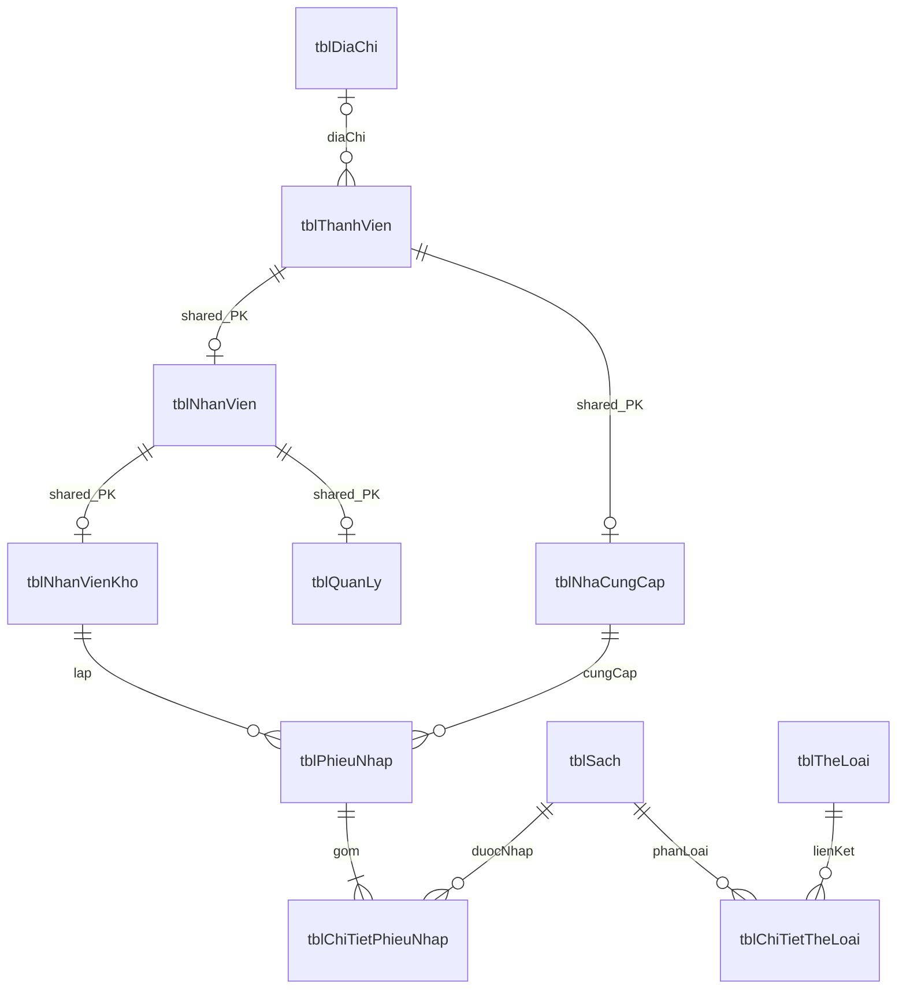

# Thiết kế CSDL — Library Management System Module 03

**Trạng thái:** Đã cập nhật theo quyết định phê duyệt chính thức (ngày 05/11/2026). Nguồn: PDF trang 15–18, 35–39; đối chiếu form trang 40–54 và các quyết định Q00–Q17 đã được phê duyệt trong [requirements.md](requirements.md). Chưa tạo migration hay DB.

## 1. Nguyên tắc và khác biệt với báo cáo

Giữ **11 bảng nghiệp vụ** của báo cáo theo phương án A đã được phê duyệt chính thức trong [architecture.md](architecture.md). Giữ đúng tên bảng/cột để dễ đối chiếu; tên bảng dùng nhất quán trên cả Windows và MySQL Linux. Không tạo bảng `HoTen`, `TKNhaCungCap`, tổng tiền hoặc tổng số lượng.

| Thiết kế báo cáo [BC] | Thiết kế vật lý đã duyệt | Căn cứ phê duyệt |
|---|---|---|
| `integer(10)` cho ID | `BIGINT` signed, JPA `Long` | Kiểu số định danh thống nhất; `(10)` không dùng làm giới hạn số chữ số |
| `double` cho tiền | `DECIMAL(19,2)`, Java `BigDecimal` | Tránh sai số dấu phẩy động; tiền VND nguyên, không có tiền lẻ thập phân; đơn giá bắt buộc $> 0$ (Q06 đã duyệt) |
| Các chuỗi `varchar(255)` | Giữ tối đa 255, password chứa hash | Không thêm giới hạn độ dài nghiệp vụ chưa được nêu |
| `ngayLap date` | `DATE`, Java `LocalDate` | Server time `Asia/Ho_Chi_Minh`, bao gồm hai đầu ngày (Q15 đã duyệt) |
| NCC chỉ có mã/trạng thái, tên từ ThanhVien | Bổ sung `tenNCC`, `nguoiLienHe` | Bổ sung chính thức theo Q04; tên công ty không phải họ/tên cá nhân |
| Credential ở ThanhVien cho mọi subtype | NULL cho hồ sơ NCC (chưa có tài khoản) | Q03 đã duyệt: NCC chưa có tài khoản đăng nhập, nhân viên bắt buộc có credential |
| Chưa có version/token | Thêm `version` trên root ThanhVien, `confirmationToken` trên phiếu | Q09 đã duyệt: chống sinh phiếu lặp và bảo vệ concurrency |
| Chưa mô tả constraint/index | Thêm FK/UNIQUE/CHECK/index | Bảo toàn quan hệ và hỗ trợ truy vấn; CHECK `soLuong > 0`, `donGia > 0` |

MySQL 8, InnoDB, `utf8mb4`; collation text `utf8mb4_0900_ai_ci` để tìm tên không phân biệt hoa/thường/dấu. Mã NCC và mã sách do người dùng nhập tay (trim + viết hoa, UNIQUE theo Q05).

Trong từ điển dưới đây: **NN** = NOT NULL, **NULL** = tùy chọn, **PK** = primary key, **FK** = foreign key, **UQ** = unique. Mọi `id` độc lập là BIGINT AUTO_INCREMENT; shared PK subtype không tự tăng.

## 2. Thực thể và quan hệ

| Đối tượng | Vai trò | Quan hệ |
|---|---|---|
| ThanhVien / HoTen | Hồ sơ chung, credential, họ/tên | HoTen gộp ho/tenDem/ten; thành viên tham chiếu một địa chỉ, optional theo Q04 |
| NhanVien | Kế thừa ThanhVien, thêm vị trí | Shared PK với ThanhVien |
| NhanVienKho / QuanLy | Kế thừa NhanVien | Shared PK với NhanVien; quyền dựa subtype |
| NhaCungCap | Kế thừa ThanhVien, mã/trạng thái hợp tác | 1:N với PhieuNhap |
| PhieuNhap | Một lần nhập từ một NCC, do một NV kho lập | 1:N với chi tiết; hoàn tất có ≥1 dòng |
| Sach | Đầu sách và tồn số bản | 1:N với chi tiết phiếu; N:N với thể loại |
| ChiTietPhieuNhap | Số bản và đơn giá tại lần nhập | Một phiếu, một sách, cặp liên kết duy nhất |
| TheLoai / ChiTietTheLoai | Thể loại và liên kết sách–thể loại | Hai quan hệ 1:N qua bảng liên kết có ghi chú |
| TKNhaCungCap | Kết quả thống kê, không phải entity lưu trữ | DTO/projection; không tạo bảng/kế thừa JPA từ NCC |



ERD phản ánh phương án chờ duyệt: địa chỉ optional, số thể loại tối thiểu chưa chốt Q12. Constraint “phiếu có ít nhất một dòng” không được bảo đảm chỉ bằng FK; service kiểm tra và lưu cùng transaction. Các subtype là quan hệ kế thừa, không phải 1:1 giữa hai thực thể độc lập tùy ý.

## 3. Từ điển 11 bảng

### 3.1 `tblDiaChi`

| Cột | Kiểu | Ràng buộc |
|---|---|---|
| id | BIGINT | PK, NN, AUTO_INCREMENT |
| soNha | VARCHAR(255) | NULL |
| toaNha | VARCHAR(255) | NULL |
| xomPho | VARCHAR(255) | NULL |
| phuongXa | VARCHAR(255) | NULL |
| quanHuyen | VARCHAR(255) | NULL |
| tinhThanh | VARCHAR(255) | NULL |

Đúng thuộc tính [BC]. Form địa chỉ cấu trúc là đề xuất Q04; không suy luận các cấp hành chính từ chuỗi tự do. Nếu yêu cầu địa chỉ bắt buộc, service phải kiểm tra có nội dung ở tổ hợp trường được duyệt, không bắt buộc mọi địa chỉ đều có tòa nhà/số nhà. Một địa chỉ có thể được nhiều thành viên tham chiếu; sửa địa chỉ một NCC bằng cách tạo bản ghi mới và đổi FK [ĐX], không sửa địa chỉ chung.

### 3.2 `tblThanhVien`

| Cột | Kiểu | Ràng buộc |
|---|---|---|
| id | BIGINT | PK, NN, AUTO_INCREMENT |
| username | VARCHAR(255) | UQ, NULL chỉ cho hồ sơ không có tài khoản theo Q03 |
| password | VARCHAR(255) | Hash đã encode; NULL theo Q03, không lưu plain text |
| ho | VARCHAR(255) | NULL cho tổ chức; cá nhân theo dữ liệu được duyệt |
| tenDem | VARCHAR(255) | NULL |
| ten | VARCHAR(255) | NULL cho tổ chức, không nhét tên công ty vào đây |
| ngaySinh | DATE | NULL; không ép tổ chức có ngày sinh |
| email | VARCHAR(255) | NULL; không tự đặt UNIQUE email |
| sdt | VARCHAR(255) | NULL; chuỗi giữ số 0 đầu |
| ghiChu | VARCHAR(255) | NULL |
| tblDiaChiId | BIGINT | NULL, FK → tblDiaChi.id |
| version | BIGINT | **Bổ sung [ĐX]**; NN, @Version tại root ThanhVien, khởi tạo 0; các subtype kế thừa |

Đề xuất CHECK: `(username IS NULL AND password IS NULL) OR (username IS NOT NULL AND password IS NOT NULL)`; service bắt buộc cả hai cho tài khoản nhân viên, từ chối hồ sơ NCC đăng nhập trong phạm vi hiện tại. Điều kiện phụ thuộc subtype không thực thi được bằng CHECK một bảng; dùng service + integration test, không giả định DB tự bảo đảm. Q03 có thể thay đổi thiết kế này.

### 3.3 `tblNhanVien`

| Cột | Kiểu | Ràng buộc |
|---|---|---|
| tblThanhVienId | BIGINT | PK, FK → tblThanhVien.id, NN |
| viTri | VARCHAR(255) | NULL; thông tin hiển thị, không dùng làm authority |

### 3.4 `tblNhanVienKho`

| Cột | Kiểu | Ràng buộc |
|---|---|---|
| tblThanhVienId | BIGINT | PK, FK → tblNhanVien.tblThanhVienId, NN |

### 3.5 `tblQuanLy`

| Cột | Kiểu | Ràng buộc |
|---|---|---|
| tblThanhVienId | BIGINT | PK, FK → tblNhanVien.tblThanhVienId, NN |

Theo đề xuất Q16, một principal thuộc một subtype cụ thể (kho hoặc quản lý hoặc NCC); không tạo cùng ID ở hai leaf subtype rồi kỳ vọng JPA JOINED hiểu một entity có nhiều lớp con. Nếu duyệt quyền kiêm nhiệm phải thiết kế lại mapping authority trước T1.

### 3.6 `tblNhaCungCap`

| Cột | Kiểu | Ràng buộc |
|---|---|---|
| tblThanhVienId | BIGINT | PK, FK → tblThanhVien.id, NN |
| maNCC | VARCHAR(255) | NN, UQ; người dùng nhập tay bất biến, viết hoa không dấu (Q05 đã duyệt) |
| trangThaiHopTac | VARCHAR(255) | NN, DEFAULT 'ACTIVE'; bộ giá trị `ACTIVE`/`INACTIVE` (Q10 đã duyệt) |
| tenNCC | VARCHAR(255) | NN, không rỗng (bổ sung chính thức theo Q04) |
| nguoiLienHe | VARCHAR(255) | NULL, không gộp với tên NCC (bổ sung theo Q04) |

SĐT/email/ghi chú/địa chỉ và version nằm ở ThanhVien, không lặp cột ở NCC. Trạng thái mặc định `ACTIVE` khi tạo mới trong luồng nhập sách. Không triển khai chức năng đổi trạng thái hay xóa NCC độc lập tại UC02 (Q02 đã duyệt).

### 3.7 `tblSach`

| Cột | Kiểu | Ràng buộc |
|---|---|---|
| id | BIGINT | PK, NN, AUTO_INCREMENT |
| maSach | VARCHAR(255) | NN, UQ, không rỗng; người dùng nhập tay (Q05 đã duyệt) |
| tenSach | VARCHAR(255) | NN, không rỗng |
| tacGia | VARCHAR(255) | NULL |
| nhaXuatBan | VARCHAR(255) | NULL |
| namXuatBan | INT | NULL; nếu có > 0 |
| tonKho | INT | NN, DEFAULT 0, CHECK ≥ 0 |
| moTa | VARCHAR(255) | NULL |

Sách là đầu sách, không phải từng bản có barcode. Tồn là số bản toàn kho; trong Module 03 chỉ cộng khi hoàn tất nhập nguyên tử.

### 3.8 `tblTheLoai`

| Cột | Kiểu | Ràng buộc |
|---|---|---|
| id | BIGINT | PK, NN, AUTO_INCREMENT |
| maTheLoai | VARCHAR(255) | NN, UQ |
| tenTheLoai | VARCHAR(255) | NN, không rỗng |
| moTa | VARCHAR(255) | NULL |

Chỉ đọc/chọn từ danh mục khởi tạo phục vụ nhập sách; không lập thêm CRUD thể loại (Q12 đã duyệt).

### 3.9 `tblChiTietTheLoai`

| Cột | Kiểu | Ràng buộc |
|---|---|---|
| id | BIGINT | PK, NN, AUTO_INCREMENT |
| ghiChu | VARCHAR(255) | NULL |
| tblSachId | BIGINT | NN, FK → tblSach.id |
| tblTheLoaiId | BIGINT | NN, FK → tblTheLoai.id |

`UNIQUE(tblSachId, tblTheLoaiId)` theo [BC] trang 17. Cho phép chọn $\ge 1$ thể loại có sẵn khi tạo sách (Q12).

### 3.10 `tblPhieuNhap`

| Cột | Kiểu | Ràng buộc |
|---|---|---|
| id | BIGINT | PK, NN, AUTO_INCREMENT |
| maPhieu | VARCHAR(255) | NN, UQ; server tự sinh theo quy tắc hệ thống (Q05 đã duyệt) |
| ngayLap | DATE | NN; ngày lập server theo `Asia/Ho_Chi_Minh` (Q15 đã duyệt) |
| phuongThucThanhToan | VARCHAR(255) | NN; `TIEN_MAT` hoặc `CHUYEN_KHOAN` (Q06 đã duyệt) |
| soTienDaThanhToan | DECIMAL(19,2) | NN; CHECK ≥ 0, ghi nhận trực tiếp trên phiếu, không tiền lẻ (Q06 đã duyệt) |
| trangThai | VARCHAR(255) | NN, DEFAULT 'COMPLETED' (Q10 đã duyệt) |
| tblNhanVienKhoId | BIGINT | NN, FK → tblNhanVienKho.tblThanhVienId |
| tblNhaCungCapId | BIGINT | NN, FK → tblNhaCungCap.tblThanhVienId |
| confirmationToken | VARCHAR(36) | NN, UQ; UUID của draft để chống sinh phiếu lặp (Q09 đã duyệt) |

Không có bản ghi nháp DB theo Q09 (nháp lưu trong Session). Q06 đã duyệt không cần danh mục trạng thái trả thiếu/đủ/đơn giá 0/tiền lẻ: `soTienDaThanhToan` ghi nhận giá trị người dùng nhập, không tạo ledger công nợ phức tạp.

### 3.11 `tblChiTietPhieuNhap`

| Cột | Kiểu | Ràng buộc |
|---|---|---|
| id | BIGINT | PK, NN, AUTO_INCREMENT |
| soLuong | INT | NN, CHECK (soLuong > 0) |
| donGia | DECIMAL(19,2) | NN, CHECK (donGia > 0) (Q06 đã duyệt: bắt buộc $> 0$, không cho phép đơn giá 0, VND nguyên) |
| tblPhieuNhapId | BIGINT | NN, FK → tblPhieuNhap.id |
| tblSachId | BIGINT | NN, FK → tblSach.id |

`UNIQUE(tblPhieuNhapId, tblSachId)` theo [BC] trang 17; trùng sách thì báo lỗi (Q11 đã duyệt). Không lưu `thanhTien` vì là dữ liệu dẫn xuất (`soLuong × donGia` theo Q13). Không làm tròn ngầm.

## 4. Khóa ngoại, vòng đời và xóa

| FK từ | Đến | Khi xóa / ý nghĩa |
|---|---|---|
| ThanhVien.tblDiaChiId | DiaChi.id | RESTRICT, không xóa địa chỉ đang được dùng |
| NhanVien.tblThanhVienId | ThanhVien.id | RESTRICT |
| NhanVienKho.tblThanhVienId | NhanVien.tblThanhVienId | RESTRICT |
| QuanLy.tblThanhVienId | NhanVien.tblThanhVienId | RESTRICT |
| NhaCungCap.tblThanhVienId | ThanhVien.id | RESTRICT |
| PhieuNhap.tblNhanVienKhoId | NhanVienKho.tblThanhVienId | RESTRICT, giữ người lập |
| PhieuNhap.tblNhaCungCapId | NhaCungCap.tblThanhVienId | RESTRICT, chặn xóa NCC có phiếu |
| ChiTietPhieuNhap.tblPhieuNhapId | PhieuNhap.id | RESTRICT; Module 03 không xóa phiếu hoàn tất |
| ChiTietPhieuNhap.tblSachId | Sach.id | RESTRICT, không xóa sách có lịch sử |
| ChiTietTheLoai.tblSachId | Sach.id | RESTRICT |
| ChiTietTheLoai.tblTheLoaiId | TheLoai.id | RESTRICT |

Tất cả ON UPDATE RESTRICT; không đổi PK. Không bật cascade xóa dữ liệu nghiệp vụ.

**Lưu ý nghiệp vụ:** Q02 đã phê duyệt **KHÔNG CRUD nhà cung cấp độc lập** (không có chức năng xóa NCC). Mọi NCC và phiếu nhập đã tạo đều được bảo toàn lịch sử giao dịch. Ràng buộc FK RESTRICT bảo vệ toàn vẹn dữ liệu ở mức DB chống lại bất kỳ hành vi xóa vi phạm quan hệ.

## 5. Index và ràng buộc bổ sung

| Bảng | Index đề xuất | Truy vấn được hỗ trợ |
|---|---|---|
| ThanhVien | UNIQUE(username) | Đăng nhập; nhiều NULL cho NCC không credential theo Q03 |
| NhaCungCap | UNIQUE(maNCC); INDEX(tenNCC) sau Q04 | Tìm mã/tên; contains `%keyword%` có thể vẫn scan |
| Sach | UNIQUE(maSach); INDEX(tenSach) | Tìm mã/tên; không hứa B-tree tối ưu contains |
| TheLoai | UNIQUE(maTheLoai) | Định danh danh mục |
| ChiTietTheLoai | UNIQUE(tblSachId, tblTheLoaiId); INDEX(tblTheLoaiId) | Fetch sách–thể loại, chiều ngược |
| PhieuNhap | UNIQUE(maPhieu); UNIQUE(confirmationToken) | Sinh mã, chống hoàn tất lặp |
| PhieuNhap | INDEX(trangThai, ngayLap, tblNhaCungCapId) | Tổng hợp theo trạng thái/ngày |
| PhieuNhap | INDEX(tblNhaCungCapId, trangThai, ngayLap, id) | Xem phiếu NCC trong kỳ |
| ChiTietPhieuNhap | UNIQUE(tblPhieuNhapId, tblSachId); INDEX(tblSachId) | Join chi tiết, bảo vệ cặp duy nhất, FK sách |

MySQL cần index FK; migration kiểm tra index DB tạo sẵn để không tạo bản trùng không cần thiết. Khi triển khai, chạy EXPLAIN với dữ liệu đủ đại diện; chưa có quy mô dữ liệu để đặt chỉ tiêu hiệu năng cố định.

CHECK chỉ hữu ích khi DB thực thi: MySQL bắt đầu hỗ trợ CHECK thực thi từ 8.0.16. [Tài liệu MySQL](https://dev.mysql.com/blog-archive/mysql-8-0-16-introducing-check-constraint/). UNIQUE/FK vẫn cần bên cạnh precheck ở service để bảo vệ các request đồng thời; hành vi FK RESTRICT đối chiếu [MySQL Foreign Key Constraints](https://dev.mysql.com/doc/refman/8.0/en/create-table-foreign-keys.html).

## 6. Tổng hợp và tiêu chí lọc đã duyệt

Mẫu truy vấn logic đã được phê duyệt theo Q04/Q10/Q13/Q15; tham số là bind parameters, không nối SQL từ input:

```sql
SELECT n.tblThanhVienId AS supplierId, n.maNCC, n.tenNCC,
       SUM(d.soLuong) AS tongSoLuong,
       SUM(d.soLuong * d.donGia) AS tongChiPhi,
       COUNT(DISTINCT d.tblSachId) AS soDauSach
FROM tblNhaCungCap n
JOIN tblPhieuNhap p ON p.tblNhaCungCapId = n.tblThanhVienId
JOIN tblChiTietPhieuNhap d ON d.tblPhieuNhapId = p.id
WHERE p.ngayLap >= :fromDate AND p.ngayLap <= :toDate
  AND p.trangThai = 'COMPLETED'
GROUP BY n.tblThanhVienId, n.maNCC, n.tenNCC
ORDER BY tongSoLuong DESC, n.maNCC ASC, n.tblThanhVienId ASC;
```

Cột `soDauSach` được tính bằng `COUNT(DISTINCT d.tblSachId)` (Q15 đã duyệt). Không join `tblChiTietTheLoai` vào truy vấn SUM để tránh nhân đôi số liệu. Query tổng trang độc lập: đếm DISTINCT NCC, SUM lượng/tiền và COUNT DISTINCT sách trên toàn kỳ trước phân trang; không cộng số đầu sách của từng NCC vì một sách có thể đến từ nhiều NCC.

Danh sách phiếu dùng cùng predicate ngày/trạng thái và thêm `p.tblNhaCungCapId = :supplierId`, group theo phiếu. Chi tiết lọc đồng thời receiptId/supplierId/ngày/trạng thái. Cột ngayLap DATE dùng hai đầu mút bao gồm (`from <= ngayLap <= to`).

## 7. Mapping JPA và bảo toàn dữ liệu

- `ThanhVien`: root `@Inheritance(JOINED)`; `NhanVien`, `NhanVienKho`, `QuanLy`, `NhaCungCap` dùng shared PK qua `@PrimaryKeyJoinColumn(name="tblThanhVienId")`. Không thêm discriminator column nếu không cần; kiểm tra schema sinh/mapping bằng MySQL ở T1.
- `HoTen`: `@Embeddable`, cột ho/tenDem/ten; không có ID/bảng riêng dù sơ đồ lớp có id.
- Quan hệ many-to-one dùng LAZY và JOIN/fetch có chủ đích trong service; không dùng EAGER toàn bộ graph.
- `PhieuNhap.details`: cascade PERSIST phục vụ tạo phiếu; không cascade REMOVE tới danh mục. Chi tiết thể loại là entity riêng theo bảng có ghiChu.
- Khai báo @Version tại root ThanhVien, NCC kế thừa version này; không khai báo @Version mới trên subclass JOINED. Không có CRUD NCC độc lập (Q02), nên version bảo vệ toàn vẹn entity khi có các cập nhật hệ thống. Sách dùng khóa pessimistic write khi tăng tồn.
- Không lưu `TKNhaCungCap` như entity con của NCC: report DTO tương ứng ý nghĩa bảng thống kê không lưu riêng ở trang 37.
- Một transaction hoàn tất chứa insert phiếu, insert mọi dòng và update tồn; unique token tranh chấp phải rollback toàn transaction thua.
- Lịch sử tên/địa chỉ theo danh mục hiện tại là quyết định Q17 đã duyệt. Không âm thầm thêm snapshot, không sửa giá/lượng phiếu đã hoàn tất.

## 8. Kế hoạch migration và kiểm chứng

`V1__module03_schema.sql` tạo 11 bảng theo thứ tự: địa chỉ → thành viên → nhân viên → kho/quản lý/NCC → sách/thể loại → liên kết thể loại → phiếu → chi tiết. Các cột và constraint đã phê duyệt chính thức đưa vào V1.

Seed chỉ ở dev/test: tài khoản kho/quản lý có hash từ mật khẩu môi trường thử nghiệm; NCC Kim Đồng/Nhã Nam; thể loại và sách mẫu. Sử dụng số liệu tính chuẩn theo công thức toán học (`thanhTien = soLuong * donGia`).

Kiểm tra trên MySQL 8: đủ 11 bảng và FK; shared PK; credential nullable chỉ cho NCC; UNIQUE mã/cặp liên kết/token; CHECK `soLuong > 0`, `donGia > 0`; rollback không tăng tồn; hai phiếu cùng sách cộng đủ; sách nhiều thể loại không nhân tổng thống kê. Toàn bộ thiết kế đã đồng bộ với các quyết định phê duyệt ngày 05/11/2026.
