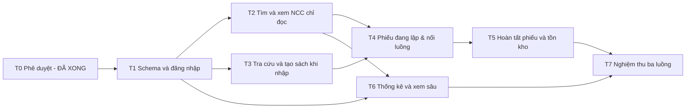

# Library Management System Module 03 — Implementation Plan

> **For agentic workers:** REQUIRED SUB-SKILL: Use superpowers:subagent-driven-development (recommended) or superpowers:executing-plans to implement this plan task-by-task. Steps use checkbox (`- [ ]`) syntax for tracking.

**Goal:** Triển khai ba chức năng nhập sách, quản lý NCC, thống kê NCC theo lượng sách nhập sau khi người dùng phê duyệt thiết kế và các quyết định nghiệp vụ liên quan.

**Architecture:** Spring MVC monolith, Controller → Service → Repository → MySQL. Thymeleaf/Bootstrap dựng HTML; Spring Security kiểm soát quyền; service giữ transaction, tính tiền và điều phối cập nhật tồn. Phương án A giữ 11 bảng và kế thừa JOINED đang là đề xuất chờ duyệt.

**Tech Stack:** Java 17; Spring Boot 3.x; Spring Security; Spring Data JPA; MySQL 8; Thymeleaf; Bootstrap 5; Gradle (Groovy DSL).

**Spec:** [requirements.md](requirements.md), [architecture.md](architecture.md), [database-design.md](database-design.md); nguồn PDF được liên kết trong requirements. Người triển khai phải đọc cả bốn tài liệu.

**Trạng thái:** Đã cập nhật theo quyết định phê duyệt chính thức (ngày 05/11/2026). Các quyết định Q00–Q17 đã được chốt và đồng bộ hoàn toàn vào toàn bộ tài liệu thiết kế. Sẵn sàng cho các task triển khai theo kế hoạch.

## Global Constraints

- Java 17.
- Spring Boot 3.x.
- Spring Security.
- Spring Data JPA.
- MySQL 8.
- Thymeleaf.
- Bootstrap 5.
- Gradle (Groovy DSL).
- Controller → Service → Repository → Database.
- Phương án A (11 bảng, JOINED) đã được phê duyệt.
- Q02 đã duyệt: Không CRUD nhà cung cấp độc lập; chỉ làm sâu chức năng xem (danh sách, tìm kiếm, chi tiết chỉ đọc). Thêm nhanh NCC chỉ nằm trong luồng nhập sách.
- Q06 đã duyệt: Đơn giá $> 0$ (không có đơn giá 0), số lượng $> 0$, tiền tệ VND nguyên (không tiền lẻ thập phân), thanh toán ghi nhận trực tiếp trên phiếu, không quản lý danh mục nợ/trả thiếu/trả đủ.
- Toàn bộ các quyết định Q00–Q17 đã chốt dứt khoát tại [requirements.md](requirements.md).

## Review Focus

1. Hai request hoàn tất cùng UUID, kể cả phản hồi đầu bị mất: chỉ một phiếu, tăng tồn một lần; token sai actor/payload bị từ chối. Test bắt buộc ở T5.
2. Hai nhân viên hoàn tất hai phiếu chứa cùng sách: tồn cộng đủ; lưu lỗi ở dòng sau rollback cả các dòng trước. Test bắt buộc ở T5.
3. Không có chức năng xóa/sửa NCC độc lập (Q02); NCC INACTIVE không cho lập phiếu mới (Q10). Test bắt buộc ở T2/T5.
4. Một sách có nhiều thể loại, xuất hiện ở nhiều NCC và nằm đúng biên ngày: báo cáo không nhân SUM; distinct đầu sách và tổng trước phân trang chính xác. Test bắt buộc ở T6.
5. Hai tab lập phiếu, hết phiên hoặc sửa ID/NCC/khoảng ngày khi xem sâu: nháp không lẫn; quyền và bộ lọc vẫn được kiểm tra phía server. Test bắt buộc ở T4/T6/T7.

---

## 1. Bản đồ file và trách nhiệm

Các đường dẫn sau là **dự kiến tạo**, không phải các file đang tồn tại. Để bảng task dễ đọc, dùng các tiền tố chính xác:

- `J/` = `src/main/java/vn/edu/library/module03/`.
- `R/` = `src/main/resources/`.
- `T/` = `src/test/java/vn/edu/library/module03/`.

Ví dụ `J/supplier/service/SupplierService.java` là đường dẫn đầy đủ `src/main/java/vn/edu/library/module03/supplier/service/SupplierService.java`. Các đường dẫn ngoài J/R/T ghi tương đối từ root project.

| Nhóm file | Trách nhiệm |
|---|---|
| `build.gradle`, `settings.gradle`, `gradlew`, `gradlew.bat`, `gradle/wrapper/gradle-wrapper.properties`, `gradle/wrapper/gradle-wrapper.jar` | Build Groovy, pin dependency/Wrapper và Java toolchain |
| `J/LibraryApplication.java`; `J/config/SecurityConfig.java`, `ClockConfig.java` | Entry point, security, Clock nghiệp vụ |
| `J/identity/{entity,repository,security,controller,dto}/` | Kế thừa tài khoản, xác thực, trang chủ |
| `J/supplier/{entity,repository,service,controller,dto}/` | Tra cứu và xem chi tiết NCC chỉ đọc |
| `J/catalog/{entity,repository,service,controller,dto}/` | Sách, thể loại, tra cứu/tạo khi nhập |
| `J/receipt/{entity,repository,service,controller,dto}/` | Phiếu, nháp, hoàn tất nguyên tử |
| `J/report/{repository,service,controller,dto}/` | Projection, truy vấn tổng hợp, xem sâu |
| `J/shared/{exception,web}/` | Lỗi nghiệp vụ, HTTP error handling |
| `R/db/migration/V1__module03_schema.sql` | Schema được duyệt, 11 bảng và constraint |
| `R/templates/`, `R/static/` | HTML Thymeleaf, Bootstrap 5 cục bộ, CSS/JS vừa đủ |
| `T/support/MySqlIntegrationSupport.java`; `src/test/resources/application-test.yml` | Hạ tầng integration test MySQL 8 dùng chung |

Không tạo sẵn interface/implementation trùng nhau khi không có nhu cầu thay thế. `SupplierReportRepository` có thể là lớp query với EntityManager; các repository entity dùng Spring Data JPA. Các DTO giữ đúng tên/kiểu theo architecture mục 5.

## 2. Thứ tự, phụ thuộc và mốc kiểm tra

- M1 sau T1: schema/mapping trên MySQL và hai tài khoản nội bộ đăng nhập đúng quyền.
- M2 sau T2/T3: danh mục NCC/sách sẵn sàng phục vụ nhập sách.
- M3 sau T5: thực hiện trọn luồng nhập, kiểm chứng rollback/cạnh tranh/gửi lặp.
- M4 sau T6/T7: thống kê đối chiếu được với phiếu, nghiệm thu đủ ba chức năng.

## 3. Các task triển khai sau phê duyệt

### T0 — Chốt thiết kế và quyết định nghiệp vụ (ĐÃ HOÀN THÀNH)

**Files:** cập nhật `docs/requirements.md`, `docs/architecture.md`, `docs/database-design.md`, `docs/implementation-plan.md` theo ý kiến duyệt.

**Interfaces:** tiêu thụ PDF và Q00–Q17; tạo baseline thiết kế đã duyệt, bộ giá trị trạng thái/thanh toán, quy tắc mã/ngày/tên/địa chỉ và validation rõ ràng.

- [x] Xác nhận Q00 và duyệt phạm vi Q01/Q02 (không CRUD NCC độc lập, chỉ làm sâu chức năng xem); ghi quyết định trong bảng Q.
- [x] Chốt phương án A (11 bảng, JOINED); Q03/Q04/Q16 về tài khoản/tên/địa chỉ/quyền.
- [x] Chốt Q05–Q12 về mã, tiền (VND nguyên, đơn giá $>0$, không tiền lẻ), hướng đi sau tạo, nháp, trạng thái và chọn lặp/thể loại.
- [x] Chốt Q13–Q15/Q17 về ví dụ số học, điều hướng đóng, ngày lọc/cột đầu sách và lịch sử; cập nhật fixture/DTO/routes nhất quán.
- [x] Người dùng đã phê duyệt thiết kế/baseline chính thức ngày 05/11/2026.

**Kết quả nghiệm thu T0:** Toàn bộ bộ tài liệu đã đồng bộ và sẵn sàng cho các task kỹ thuật.

### T1 — Nền tảng schema, mapping và đăng nhập hai vai trò

**Phụ thuộc:** T0, đặc biệt Q03/Q04/Q05/Q06/Q10/Q12/Q15/Q16. Phạm vi nền tảng này cần schema cuối đã thống nhất, không migration thử theo giả định.

**Files tạo:**

- Build/Wrapper liệt kê ở mục 1; `.gitignore`, `.env.example` chỉ chứa tên biến và giá trị mẫu không bí mật.
- `J/LibraryApplication.java`, `J/config/SecurityConfig.java`, `J/config/ClockConfig.java`.
- `J/identity/entity/ThanhVien.java`, `HoTen.java`, `DiaChi.java`, `NhanVien.java`, `NhanVienKho.java`, `QuanLy.java`.
- `J/supplier/entity/NhaCungCap.java`, `SupplierStatus.java`; `J/catalog/entity/Sach.java`, `TheLoai.java`, `ChiTietTheLoai.java`; `J/receipt/entity/PhieuNhap.java`, `ChiTietPhieuNhap.java`, `ReceiptStatus.java`, `PaymentMethod.java`.
- `J/identity/repository/ThanhVienRepository.java`; `J/identity/security/LibraryUserDetailsService.java`, `LibraryPrincipal.java`; `J/identity/controller/AuthController.java`, `HomeController.java`.
- `R/application.yml`, `R/application-dev.yml`, `R/db/migration/V1__module03_schema.sql`.
- `R/templates/auth/login.html`, `R/templates/home/warehouse.html`, `manager.html`; `R/templates/error/403.html`; `R/templates/fragments/layout.html`; `R/static/vendor/bootstrap/` với bản 5 đã pin; `R/static/css/app.css`.
- `T/support/MySqlIntegrationSupport.java`, `T/identity/SchemaMappingIntegrationTest.java`, `T/identity/AuthAndAuthorizationTest.java`, `src/test/resources/application-test.yml`.

**Interfaces:**

- Tiêu thụ schema/database-design mục 3–7 đã duyệt.
- Tạo `LibraryPrincipal(memberId: long, username: String, authorities)` và `Clock` bean; entity ID `Long`, ngày `LocalDate`, tiền `BigDecimal`; tên bảng/cột đúng từ điển.
- `ThanhVienRepository.findByUsername(String username): Optional<ThanhVien>`; UserDetailsService `loadUserByUsername(String username): UserDetails`.
- GET `/warehouse`, `/manager`, `/login`; POST `/login`/`/logout` do security filter xử lý.

- [ ] Chuẩn bị build/Wrapper và test harness tối thiểu; viết `SchemaMappingIntegrationTest.mapsExactlyElevenBusinessTables()` và `AuthAndAuthorizationTest.redirectsAnonymousAndRejectsWrongRole()`. Assert đủ 11 bảng nghiệp vụ (không tính bảng lịch sử Flyway), shared PK; kho vào `/warehouse` 200, quản lý vào `/warehouse` 403 và ngược lại; anonymous redirect login.
- [ ] Chạy `.\gradlew.bat test --tests '*SchemaMappingIntegrationTest' --tests '*AuthAndAuthorizationTest'` sau khi Wrapper sẵn sàng. Expected RED do thiếu migration/mapping/security, không do mất DB hoặc dependency. Lỗi hạ tầng phải khắc phục trước khi kết luận test RED có ý nghĩa.
- [ ] Tạo migration/entity/config/controller/template tối thiểu đúng các hợp đồng trên. Root JOINED, subtype shared PK, credential/hash theo baseline; không seed password thật; authority từ subtype. Kiểm tra bản ghi NCC không credential không được xác thực nội bộ.
- [ ] Thêm assertion đăng nhập sai không tạo principal, hash khác mật khẩu gốc; POST thiếu CSRF 403; logout POST hủy phiên. `ddl-auto=validate`, `open-in-view=false`.
- [ ] Chạy lại hai test và `.\gradlew.bat bootJar`. Expected GREEN, không lỗi mapping/Flyway. Nếu không có Docker, dùng MySQL 8 test riêng với DB được reset có kiểm soát; không thay bằng H2 rồi tuyên bố đã chứng minh MySQL.
- [ ] Review nền tảng và tạo commit cục bộ `feat: initialize module03 schema and secured MVC shell` nếu workspace đã là Git repository và được phép commit. Hiện workspace chưa có `.git`; không tự khởi tạo Git chỉ để đáp ứng bước này.

**Kết quả nghiệm thu:** đăng nhập hai vai trò hoạt động trên schema MySQL 8 được duyệt, các request sai quyền bị chặn trước nghiệp vụ.

### T2 — Tìm kiếm và xem chi tiết NCC (chỉ đọc)

**Phụ thuộc:** T1; Q02/Q04/Q14 đã duyệt. Theo quyết định Q02, chỉ triển khai chức năng tra cứu, xem danh sách và xem chi tiết chỉ đọc; không triển khai thêm, sửa, xóa, ngừng hoạt động NCC độc lập.

**Files tạo:** `J/supplier/repository/NhaCungCapRepository.java`; `J/supplier/service/SupplierService.java`; `J/supplier/controller/SupplierController.java`; `J/supplier/dto/SupplierSummary.java`, `SupplierDetail.java`; `J/shared/exception/ResourceNotFoundException.java`; `J/shared/web/GlobalExceptionHandler.java`; `R/templates/suppliers/menu.html`, `list.html`, `detail.html`; `R/templates/error/404.html`; `T/supplier/SupplierReadIntegrationTest.java`, `SupplierControllerTest.java`.

**Interfaces:** tiêu thụ NhaCungCap/ThanhVien/DiaChi của T1; tạo `SupplierService.search(String keyword, Pageable pageable): Page<SupplierSummary>` và `get(long supplierId): SupplierDetail`. DTO đúng architecture mục 5. Repository query fetch thông tin liên hệ/địa chỉ trong transaction.

- [ ] Viết `SupplierReadIntegrationTest.findsByCodeAndNameAndReturnsEmptyWhenUnmatched()`: fixture NCC005 “Công ty CP Nhã Nam”; tìm mã hoặc “Nhã Nam” ra đúng hồ sơ; tìm “khong-co-ncc” trả page rỗng; keyword rỗng trả danh sách gốc; hai NCC cùng tên không bị gộp.
- [ ] Chạy `.\gradlew.bat test --tests '*SupplierReadIntegrationTest'`; expected RED vì service/query chưa có.
- [ ] Triển khai hai method, route `/suppliers/menu`, `/suppliers`, `/suppliers/{id}` và UI08–10; phân trang size 20/max 100; giữ từ khóa/trang khi đóng chi tiết về danh sách (Q14).
- [ ] Viết `SupplierControllerTest.detailIsReadOnlyAndBackPreservesSearch()`; assert tên, liên hệ, địa chỉ chi tiết, trạng thái/ghi chú, hoàn toàn không có form hoặc nút chỉnh sửa/xóa ở màn xem; ID lạ trả 404, quản lý không đọc route kho. Test chuỗi chứa markup được escape khi hiển thị.
- [ ] Chạy `.\gradlew.bat test --tests '*SupplierReadIntegrationTest' --tests '*SupplierControllerTest'`; expected GREEN, không lazy-load error; review UC02 xem và checkpoint `feat: add supplier search and read-only detail` khi có Git.

**Kết quả nghiệm thu:** tìm/xem NCC theo trang 12–13; màn hình chỉ đọc; không có kết quả là trạng thái hợp lệ, khác lỗi DB.

> **Ghi chú quyết định phê duyệt Q02:** Task CRUD NCC độc lập (thêm, sửa, xóa, ngừng hoạt động) được **LƯỢC BỎ KHỎI KẾ HOẠCH THI CÔNG**. Luồng tạo nhanh NCC chỉ nằm như một bước phụ trong luồng nhập sách tại T4.

### T3 — Tra cứu, tạo đầu sách và chọn thể loại khi nhập

**Phụ thuộc:** T1; Q05/Q08/Q12 đã duyệt; trường bắt buộc và thể loại khởi tạo.

**Files tạo:** `J/catalog/repository/SachRepository.java`, `TheLoaiRepository.java`; `J/catalog/service/BookCatalogService.java`; `J/catalog/controller/BookController.java`; `J/catalog/dto/BookForm.java`, `BookSummary.java`, `CategoryOption.java`; `R/templates/books/select.html`, `form.html`; `T/catalog/BookCatalogIntegrationTest.java`, `BookControllerTest.java`.

**Interfaces:** tạo `search(String, Pageable): Page<BookSummary>`, `create(BookForm): BookSummary`, `categories(): List<CategoryOption>`; service chưa tăng tồn. `SachRepository.findForUpdate(long bookId): Optional<Sach>` được dùng ở T5. BookController chỉ cho kho; route `/books`, `/books/new`, POST `/books` theo architecture.

- [ ] Viết `BookCatalogIntegrationTest.searchesCodeAndTitleAndCreatesWithMultipleCategories()`; fixture B012 tồn 15; tạo B050 với hai categoryIds hợp lệ cho tồn 0, đúng hai liên kết; mã lặp bị từ chối; categoryId không tồn tại rollback cả sách và liên kết; tập thể loại rỗng bị từ chối (tối thiểu 1 thể loại theo Q12).
- [ ] Chạy `.\gradlew.bat test --tests '*BookCatalogIntegrationTest'`; expected RED do thiếu service/query.
- [ ] Triển khai service/query và form đúng DTO; dùng Set tránh cặp thể loại lặp; chưa triển khai CRUD tác giả/NXB/thể loại; không thêm các cột không có trong schema đã duyệt.
- [ ] Viết `BookControllerTest.invalidYearOrCodeKeepsBookForm()` cho năm không phải số/năm âm, mã rỗng/trùng, output escape; trạng thái không có kết quả hiển thị nút thêm sách.
- [ ] Chạy `.\gradlew.bat test --tests '*BookCatalogIntegrationTest' --tests '*BookControllerTest'`; expected GREEN. Checkpoint `feat: search and create book titles for receiving` khi có Git.

**Kết quả nghiệm thu:** danh mục hỗ trợ tìm/tạo đầu sách, bảo toàn quan hệ N:N, chưa phát sinh nhập kho khi chỉ tạo sách.

### T4 — Lập phiếu đang nhập và nối các màn hình

**Phụ thuộc:** T2/T3; Q05–Q12/Q14 đã duyệt, đặc biệt các nhánh sau thêm mới và vòng đời nháp.

**Files tạo:** `J/receipt/dto/ReceiptLineForm.java`, `ReceiptLineView.java`, `ReceiptDraftView.java`, `PaymentForm.java`; `J/receipt/service/ReceiptDraftService.java`, `ReceiptDraftStore.java`; `J/receipt/controller/ReceiptDraftController.java`; `J/supplier/dto/SupplierForm.java`, `AddressForm.java`; `J/shared/exception/DraftNotFoundException.java`; `R/templates/receipts/supplier-select.html`, `supplier-form.html`, `draft.html`, `line-form.html`; `T/receipt/ReceiptDraftServiceTest.java`, `ReceiptDraftControllerTest.java`.

**Files sửa:** `SupplierService.java` (thêm phương thức `createForReceipt` tạo nhanh NCC khi nhập theo Q04, Q07), `BookController.java` để tiếp nhận draftId được kiểm soát; `GlobalExceptionHandler.java`.

**Interfaces:** theo architecture: `start(long supplierId, long actorId): UUID`; `get(UUID, long): ReceiptDraftView`; `addLine(UUID, long, ReceiptLineForm): ReceiptDraftView`; `discard(UUID, long): void`. `ReceiptDraftStore` session-scoped chứa nhiều draft; cung cấp `snapshot(UUID draftId, long actorId): ReceiptDraftSnapshot` và `remove(UUID draftId, long actorId): void` cho T5; tạo `J/receipt/dto/ReceiptDraftSnapshot.java`.

- [ ] Viết `ReceiptDraftServiceTest.calculates180BooksAnd16500000Vnd()`, dùng ba dòng AC01; assert tổng 180 và BigDecimal bằng 16500000, không dùng double. `rejectsEmptyQuantityAndDuplicateBookWithoutMerging()` theo Q11; không ghi receipt hoặc tăng tồn khi thêm dòng nháp; từ chối đơn giá $\le 0$ (Q06).
- [ ] Viết `ReceiptDraftControllerTest.twoTabsHaveIndependentDrafts()`; hai UUID, một actor, các dòng không lẫn. `differentActorCannotUseDraft()`; `expiredSessionShowsStartAgain()`; tạo sách/NCC rồi hủy phiếu vẫn giữ danh mục theo Q09 đã duyệt.
- [ ] Chạy `.\gradlew.bat test --tests '*ReceiptDraftServiceTest' --tests '*ReceiptDraftControllerTest'`; expected RED do chưa có nháp/điều hướng.
- [ ] Triển khai store/DTO/service/controller/UI02–07; mọi write POST/CSRF, không tin actorId hoặc tổng tiền gửi client.
- [ ] Tích hợp thêm nhanh NCC → tự chọn NCC vừa tạo và mở phiếu theo Q07; thêm sách → nhập lượng/giá theo Q08 đã duyệt; hủy form quay về đúng ngữ cảnh, không chèn dòng thiếu giá/lượng. Kiểm tra route draft và UUID quyền sở hữu trước khi nối danh mục vào phiếu.
- [ ] Chạy lại test T4 và các controller tests T2–T3 có sửa; expected GREEN. Checkpoint `feat: compose receiving drafts across supplier and book screens` khi có Git.

**Kết quả nghiệm thu:** lập phiếu nhiều sách và tính tổng đúng, hỗ trợ tạo nhanh NCC/sách trong luồng nhập, không phát sinh biến động tồn trước hoàn tất.

### T5 — Hoàn tất phiếu, thanh toán và cập nhật tồn kho

**Phụ thuộc:** T4; Q05/Q06/Q09/Q10/Q11/Q13/Q15/Q17 đã duyệt. Đây là task bắt buộc integration test transaction/cạnh tranh.

**Files tạo:** `J/receipt/repository/PhieuNhapRepository.java`; `J/receipt/service/ReceiptCompletionService.java`, `ReceiptNumberGenerator.java`; `J/receipt/controller/ReceiptCompletionController.java`; `J/receipt/dto/ReceiptSummary.java`, `ReceiptDetail.java`; `J/shared/exception/CompletionConflictException.java`; `T/receipt/ReceiptCompletionIntegrationTest.java`.

**Files sửa:** `SachRepository.java`, `NhaCungCapRepository.java` để phối hợp cùng hàng khóa; `receipts/draft.html`, `GlobalExceptionHandler.java`; `ReceiptDraftStore.java` để dọn sau commit.

**Interfaces:** `complete(UUID draftId, long actorId, PaymentForm form): ReceiptDetail`; tiêu thụ snapshot bất biến T4, repository khóa T3 và Clock T1. `ReceiptNumberGenerator.next(): String` sinh mã theo quy tắc Q05. `PhieuNhapRepository.findByConfirmationToken(String token): Optional<PhieuNhap>` và phương thức fetch detail trong transaction; không mở API sửa phiếu.

- [ ] Viết `ReceiptCompletionIntegrationTest.completesAllLinesAndIncrementsStockOnce()`; B012 ban đầu 15, nhập 50 → 65; đúng một header và ba chi tiết, tổng AC01 180/16500000; số đã trả không làm thay đổi tổng giá trị hàng; không cho phép đơn giá 0 (Q06).
- [ ] Viết `rollsBackHeaderLinesAndStockWhenLaterWriteFails()`; cố ý gây lỗi persist một chi tiết sau khi đã có thao tác trước đó; sau rollback header/chi tiết mới = 0, mọi tồn bằng trước. Không chỉ mock repository để kết luận rollback DB.
- [ ] Chạy `.\gradlew.bat test --tests '*ReceiptCompletionIntegrationTest'`; expected RED do thiếu complete/transaction.
- [ ] Triển khai `complete` qua Spring transaction proxy: kiểm tra token hoàn tất cũ, validate snapshot/payment, khóa NCC (kiểm tra ACTIVE theo Q10) rồi khóa sách theo ID tăng dần, kiểm tra overflow, sinh mã theo Q05, insert header/details và cộng tồn trong một transaction. Dọn session chỉ sau commit.
- [ ] Bổ sung `sameTokenConcurrentRequestsProduceOneReceipt()`, `lostResponseCanReplayAfterDraftWasRemoved()`, `reusedTokenWithChangedPaymentOrActorIsRejected()`. Assert một receipt, tăng tồn đúng một lần; khi tranh UNIQUE rollback transaction thua, đọc lại bằng transaction mới ngoài transaction đã thất bại.
- [ ] Bổ sung `concurrentReceiptsAccumulateStock()` với hai connection/transaction thực, tồn 15 + 50 + 30 = 95; `inactiveSupplierCannotComplete()` theo Q10.
- [ ] Bổ sung `rejectsOverpaymentInvalidScaleAndStockOverflow()` theo Q06: số lượng $\le 0$, đơn giá $\le 0$ (từ chối đơn giá 0), trả tiền âm bị từ chối; phiếu rỗng không lưu. Tuân thủ phép tính chính xác $150 \times 63.333 = 9.499.950$ (Q13).
- [ ] Chạy `.\gradlew.bat test --tests '*ReceiptCompletionIntegrationTest' --tests '*ReceiptDraftControllerTest'`; expected GREEN. Checkpoint `feat: atomically complete receipts and update stock` khi có Git.

**Kết quả nghiệm thu:** nhập sách hoàn chỉnh, nguyên tử, không mất cập nhật và không nhân đôi khi gửi lại.

### T6 — Thống kê NCC, danh sách phiếu và xem chi tiết

**Phụ thuộc:** T1/T2; Q10/Q13–Q17 đã duyệt.

**Files tạo:** `J/report/dto/ReportFilter.java`, `SupplierReportRow.java`, `ReportTotals.java`, `SupplierReportPage.java`; `J/report/repository/SupplierReportRepository.java`; `J/report/service/SupplierReportService.java`; `J/report/controller/ReportController.java`; `R/templates/reports/menu.html`, `period.html`, `suppliers.html`, `receipts.html`, `receipt-detail.html`; `T/report/SupplierReportIntegrationTest.java`, `ReportControllerTest.java`.

**Files dùng chung:** `ReceiptSummary`, `ReceiptDetail`, `ReceiptLineView` của T4/T5.

**Interfaces:** `summarize(ReportFilter filter, Pageable pageable): SupplierReportPage`; `receipts(long supplierId, ReportFilter filter, Pageable pageable): Page<ReceiptSummary>`; `detail(long supplierId, long receiptId, ReportFilter filter): ReceiptDetail`. Query tổng không join thể loại, detail kiểm tra đồng thời NCC/phiếu/kỳ/trạng thái.

- [ ] Viết `SupplierReportIntegrationTest.ranksByQuantityAndSumsGoodsValueNotPayments()`: NCC001 có hai phiếu 500/25.000.000 và 1000/50.000.000, trả tiền khác tổng hàng; expect 1500/75.000.000; thêm NCC005 1200, NCC002 850, NCC008 500, expect đúng thứ tự AC03.
- [ ] Viết `includesBothDateBoundariesAndExcludesOutsidePeriod()`: phiếu 01/01/2026 và 31/03/2026 được tính; 31/12/2025 và 01/04/2026 không tính theo Q15 đã duyệt. `returnsEmptyOnlyWhenNoMatchingReceipts()`; lỗi DB phải đi nhánh lỗi kỹ thuật.
- [ ] Chạy `.\gradlew.bat test --tests '*SupplierReportIntegrationTest'`; expected RED do chưa có query/service.
- [ ] Triển khai repository projection và tổng riêng trước phân trang theo database-design mục 6; lấy current metadata theo Q17. Đếm đầu sách dùng `COUNT(DISTINCT sachId)` theo Q15.
- [ ] Bổ sung `multipleCategoriesDoNotMultiplyTotals()` với một sách hai thể loại; `distinctTitlesAcrossSuppliersAndPageTotalsAreCorrect()` với cùng sách ở hai NCC và page size 1; assert global distinct = 1, total amount/quantity vẫn là tổng mọi phiếu; đồng hạng sắp theo mã NCC (Q15).
- [ ] Viết `ReportControllerTest.preservesPeriodAcrossDrillDownAndBack()` và `rejectsReceiptOutsideSupplierOrPeriod()`: GET các cấp giữ from/to, phiếu đổi supplierId hoặc ngoài kỳ trả 404; kho không vào báo cáo, thiếu/đảo ngày không chạy query. Tạo UI11–16, nút Đóng về trang chủ/báo cáo theo Q14.
- [ ] Chạy `.\gradlew.bat test --tests '*SupplierReportIntegrationTest' --tests '*ReportControllerTest'`; expected GREEN. Checkpoint `feat: report supplier intake with receipt drill-down` khi có Git.

**Kết quả nghiệm thu:** số tổng hợp đối chiếu được xuống phiếu/dòng, đúng thời gian/quyền, không nhân dữ liệu do N:N.

### T7 — Nghiệm thu xuyên chức năng và bàn giao

**Phụ thuộc:** T5/T6; toàn bộ các điểm phê duyệt đã hoàn tất.

**Files tạo:** `T/acceptance/Module03AcceptanceTest.java`; `docs/acceptance-checklist.md`; `README.md` hướng dẫn JDK 17/MySQL 8/environment/Gradle.

**Files sửa:** chỉ những file ứng dụng có lỗi được phát hiện và tài liệu tương ứng.

- [ ] Viết `Module03AcceptanceTest.receivingFeedsSupplierReport()` với MySQL và MockMvc: kho lập phiếu thành công → tồn tăng → quản lý tìm đúng NCC/kỳ → đúng tổng → xem phiếu/chi tiết; giả mạo actor/tổng tiền không thay đổi dữ liệu server.
- [ ] Chạy `.\gradlew.bat test --tests '*Module03AcceptanceTest'`.
- [ ] Chạy toàn bộ `.\gradlew.bat clean test bootJar`; expected build thành công, mọi test đã định nghĩa PASS.
- [ ] Thực hiện UAT thủ công: kiểm tra trình bày tiếng Việt, lỗi cạnh trường, focus/label, bảng cuộn, lịch sử khi NCC ngừng, browser back/reload, hết session, hai tab. Ghi PASS/FAIL trong acceptance checklist.
- [ ] Bàn giao README, migrations, danh sách phiên bản pin và các giới hạn được chấp thuận. Checkpoint `test: verify module03 receiving and supplier reports` khi có Git.

**Kết quả nghiệm thu:** đủ AC01–AC03, EX01–EX16 theo quyết định đã duyệt; không có yêu cầu nào chỉ được xác nhận bằng mock khi bản chất cần MySQL/transaction.

## 4. Kịch bản UAT cụ thể

| Kịch bản | Thao tác | Kết quả cần đối chiếu |
|---|---|---|
| UAT01 nhập bình thường | Kho chọn NCC, thêm ba dòng AC01, nhập thanh toán hợp lệ (tiền VND nguyên, đơn giá $>0$), hoàn tất | 180 cuốn/16.500.000 VNĐ; B012 tồn 15 → 65; một phiếu, ba dòng; về trang chủ có thông báo; không quản lý công nợ phức tạp (Q06) |
| UAT02 danh mục chưa có | Tìm NCC/sách không có, tạo mới rồi tiếp tục phiếu; thử hủy form | Đích chuyển theo Q07/Q08; không mất draft; sách chỉ tạo có tồn 0; lưu danh mục khi bỏ phiếu theo Q09 |
| UAT03 quản lý NCC | Tìm NCC005, xem danh sách, xem chi tiết, đóng về danh sách | Chi tiết chỉ đọc, hiển thị đủ thông tin, giữ từ khóa khi đóng; không có nút hay form thêm/sửa/xóa/ngừng độc lập (Q02) |
| UAT04 thống kê | Quản lý lọc Q1/2026, chọn Kim Đồng, chọn PN045/phiếu fixture tương ứng | 1.500/75.000.000 theo fixture hợp lệ; phiếu và dòng thuộc đúng kỳ/NCC; tổng khớp phép tính chuẩn xác (Q13, Q15) |
| UAT05 ngoại lệ và quyền | Sai ngày, không dữ liệu, sai quyền, CSRF thiếu, hết phiên, đơn giá $\le 0$ | Thông báo đúng loại; không ghi dữ liệu trái quyền; từ chối đơn giá 0 |
| UAT06 gửi lặp/cạnh tranh | Hai tab tạo phiếu; hai lần hoàn tất cùng token; hai phiếu cùng sách | Draft độc lập; một token chỉ tạo một phiếu; tồn cộng đủ; kiểm tra DB sau commit |

## 5. Checklist tự rà soát kế hoạch

- [x] Bao phủ ba chức năng [YC], use case/actor/BR, ngoại lệ và quyền; từng yêu cầu có task trong ma trận requirements.
- [x] Tách phần rõ trong báo cáo và phần CRUD/phạm vi còn thiếu; đã loại bỏ CRUD NCC độc lập theo Q02.
- [x] File, interface, DTO, transaction và đường đi giữa các task được đặt tên thống nhất với architecture.
- [x] Các điểm Review Focus có test cụ thể ở T2/T4/T5/T6/T7.
- [x] Không dùng H2/mock làm bằng chứng duy nhất cho constraint, locks, rollback và tổng hợp MySQL.
- [x] Không đưa application code, script migration hoặc dependency thực vào workspace trong đợt lập tài liệu.
- [x] Người dùng đã phê duyệt thiết kế và toàn bộ các quyết định Q00–Q17; kế hoạch triển khai đã được cập nhật đồng bộ hoàn toàn.

Đề nghị người dùng xem xét thiết kế và ghi các quyết định Q00–Q17. Chưa chọn cách thực thi hoặc bắt đầu triển khai trong đợt này; sau khi duyệt có thể thống nhất thực hiện trực tiếp theo task hoặc theo quy trình subagent nếu người dùng muốn.
