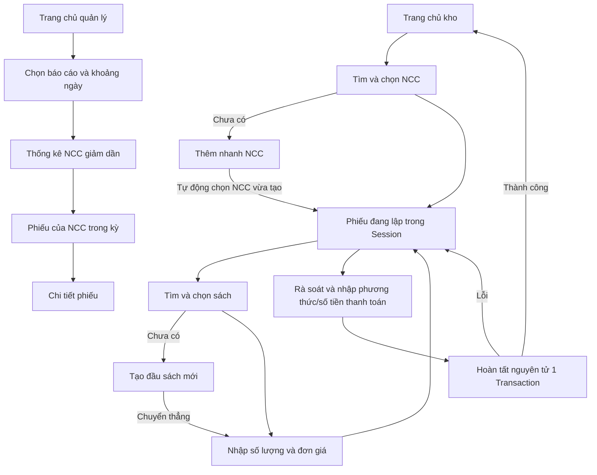

# Yêu cầu Library Management System — Module 03

**Trạng thái:** Đã phê duyệt các điểm quyết định nghiệp vụ (ngày 05/11/2026). Sẵn sàng làm căn cứ hoàn thiện tài liệu thiết kế/kế hoạch và triển khai.

## 1. Nguồn và quy ước

Nguồn thực tế: [Báo cáo tổng hợp Module 03](<requirements/B23DCCE009_Nguyễn Việt Anh_Modul 03_Chu de 01_Bao Cao Tong Hop.pdf>). Workspace không có file `docs/requirements/bao-cao-tong-hop.pdf`; file trên là PDF duy nhất trong thư mục, bìa xác định đúng Module 03 và ba chức năng được yêu cầu. Cần xác nhận đây là tài liệu chuẩn (Q00), không đổi tên hoặc sửa PDF.

Đã đọc 75/75 trang, gồm văn bản, nội dung sơ đồ vector và ảnh giao diện. Số trang dưới đây là thứ tự trang PDF (bìa là trang 1). Một số hình được đặt ở trang sau phần mô tả; không suy diễn nội dung chỉ từ mục lục.

| Phần đã đối chiếu | Trang PDF | Kết quả dùng trong thiết kế |
|---|---|---|
| Bìa, mục lục | 1–3 | Module, phạm vi và cấu trúc báo cáo |
| Use case và actor | 4–7 | Nhập sách, quản lý NCC, thống kê; có mở rộng tự quản lý NCC |
| Kịch bản chuẩn, ngoại lệ | 8–15 | Dữ liệu đầu vào, bảng kết quả, thêm mới, xem chi tiết |
| Trích lớp, quan hệ | 15–18 | Kế thừa thành viên và liên kết phiếu–sách–thể loại |
| Trạng thái, lớp phân tích | 18–29 | Các màn hình, chuyển bước và trách nhiệm phân tích |
| Giao tiếp phân tích | 30–35 | Tương tác nhân viên và NCC ngoài hệ thống |
| Thực thể, CSDL | 35–39 | 11 bảng, PK/FK và thuộc tính dẫn xuất |
| Giao diện, lớp thiết kế | 40–58 | Các ảnh màn hình và mô hình JSP/DAO |
| Hoạt động | 58–66 | Nhánh lỗi, lưu dữ liệu, thống kê giảm dần |
| Tuần tự | 66–75 | Truyền ngữ cảnh phiếu, thanh toán, xem sâu báo cáo |

Nhãn sử dụng xuyên suốt bộ tài liệu:

- **[BC]**: được báo cáo nêu rõ, kèm trang.
- **[YC]**: yêu cầu trực tiếp của người dùng, ưu tiên khi khác báo cáo.
- **[ĐX]**: đề xuất thiết kế/kỹ thuật, chưa phải nghiệp vụ đã được chấp thuận.
- **[Qxx]**: chưa rõ hoặc mâu thuẫn; phải có quyết định trước khi triển khai phần phụ thuộc.

Tài liệu liên quan: [Kiến trúc](architecture.md), [CSDL](database-design.md), [Kế hoạch triển khai](implementation-plan.md). Danh sách Q tại mục 8 là nguồn duy nhất quản lý các câu hỏi; tài liệu khác tham chiếu mã, không tự kết luận thay.

## 2. Mục tiêu, phạm vi và giới hạn

**[YC]** Hỗ trợ nhân viên kho nhập sách từ NCC, quản lý thông tin NCC, và nhân viên quản lý xem thống kê NCC theo lượng sách nhập.

Trong phạm vi:

1. Đăng nhập, đăng xuất và phân quyền cho hai actor nội bộ để thực hiện nghiệp vụ.
2. Tìm/chọn NCC; tạo nhanh NCC khi nhập sách chưa có NCC tương ứng.
3. Tìm/chọn sách; tạo đầu sách mới và gán thể loại để phục vụ nhập sách.
4. Lập phiếu nhiều đầu sách, nhập số lượng, đơn giá, thông tin thanh toán; hoàn tất phiếu và cập nhật tồn kho.
5. Quản lý thông tin nhà cung cấp: tìm kiếm, xem danh sách và xem chi tiết chỉ đọc (theo quyết định phê duyệt Q02; không triển khai thêm/sửa/xóa/ngừng độc lập ngoài luồng nhập sách).
6. Thống kê theo khoảng ngày; xem NCC → các phiếu trong cùng khoảng ngày → chi tiết phiếu.

Ngoài phạm vi được giao: mượn/trả sách, độc giả, phạt, doanh thu, mua hàng trực tuyến, quản lý nhân sự, cổng NCC tự phục vụ (Q01), CRUD nhà cung cấp độc lập ngoài luồng nhập sách (Q02), danh mục trạng thái trả thiếu/đủ/đơn giá 0/tiền lẻ phức tạp (Q06), thanh toán qua cổng ngân hàng trực tuyến, sổ công nợ và đối soát thanh toán. Việc nhập phương thức/số tiền thanh toán là ghi nhận thông tin [BC], không phải tích hợp thanh toán hay quản lý công nợ.

Chưa có yêu cầu sửa/xóa phiếu đã hoàn tất, trả hàng NCC, duyệt phiếu nhiều cấp, quét mã từng bản sách, xuất Excel/PDF hoặc CRUD toàn bộ danh mục sách/thể loại. Không bổ sung các chức năng này ngầm vào kế hoạch.

**[YC] Ràng buộc:** Java 17; Spring Boot 3.x; Spring Security; Spring Data JPA; MySQL 8; Thymeleaf; Bootstrap 5; Gradle Groovy DSL. Chỉ tạo tài liệu trong đợt này.

## 3. Actors và quyền

| Actor | Vai trò trong báo cáo | Quyền trong phạm vi phê duyệt |
|---|---|---|
| Nhân viên kho | Actor chính nhập sách/quản lý NCC, trang 8–13 | Nhập sách, tra cứu/tạo sách phục vụ nhập, tạo NCC khi nhập sách, tra cứu/xem chi tiết NCC (không CRUD NCC độc lập) |
| Nhân viên quản lý | Actor chính thống kê, trang 13–15 | Xem báo cáo, danh sách phiếu và chi tiết trong luồng báo cáo |
| Nhà cung cấp | Cung cấp tên/mã, sách, giá, xác nhận giao hàng, trang 30–33, 66–72 | Actor hỗ trợ ngoài hệ thống; không có màn hình đăng nhập trong phạm vi [YC] |
| Thành viên, nhân viên | Actor/lớp khái quát, trang 4–7, 16–17 | Là cơ sở mô hình kế thừa, không tạo thêm quyền thao tác tự động |

**[ĐX]** Hai authority `ROLE_WAREHOUSE`, `ROLE_MANAGER`, không suy ra quản lý có mọi quyền của kho. Q16 xác nhận quyền kiêm nhiệm. Không tin `nhanVienId` gửi từ form; người lập phiếu được xác định từ phiên đăng nhập.

## 4. Use cases và tiêu chí chấp nhận

### UC00 — Đăng nhập và phân quyền

**Nguồn:** [BC] trang 4–8, 12–14. Actor đã có tài khoản; báo cáo không mô tả cấp tài khoản.

Luồng: nhập tài khoản/mật khẩu → xác thực → hiển thị trang chủ phù hợp → truy cập đúng chức năng → đăng xuất. **[ĐX]** Tài khoản thử nghiệm do dữ liệu khởi tạo ở môi trường phát triển cung cấp, không mở đăng ký công khai.

Chấp nhận: sai thông tin không đăng nhập được; chưa đăng nhập được đưa về trang đăng nhập; đăng nhập đúng nhưng sai quyền bị từ chối kể cả khi gõ URL/POST trực tiếp. Mật khẩu lưu dưới dạng hash; không hiển thị/log mật khẩu. Cách tạo tài khoản NCC còn chờ Q03.

### UC01 — Nhập sách từ nhà cung cấp

**Nguồn:** [BC] trang 4–5, 8–12, 18–19, 23–25, 30–31, 40–47, 58–62, 66–70.

**Tiền điều kiện:** Nhân viên kho đã đăng nhập và có quyền kho. **Hậu điều kiện thành công:** phiếu, toàn bộ chi tiết và phần tăng tồn kho được lưu nhất quán. Khi thất bại, không được có phiếu/chi tiết/tồn kho lưu dở.

Luồng chính:

1. Chọn “Nhập sách”; nhập tên hoặc mã NCC, bấm tìm kiếm.
2. Xem kết quả gồm mã, tên, SĐT, email, địa chỉ; chọn một NCC.
3. Mở phiếu đang lập với thông tin NCC/người lập và danh sách sách rỗng.
4. Chọn thêm sách; tìm theo mã hoặc tên; xem mã, tên, tác giả, thể loại, tồn kho.
5. Chọn đầu sách, nhập số lượng và đơn giá nhập thực tế; xác nhận thêm dòng.
6. Phiếu hiển thị mã/tên sách, thể loại, đơn giá, số lượng, thành tiền; cộng tổng số lượng và tổng tiền. Lặp bước 4–6 cho các đầu sách khác.
7. Rà soát thông tin hàng giao với NCC ngoài hệ thống; chọn phương thức thanh toán, nhập số tiền đã thanh toán.
8. Bấm “Xác nhận & Hoàn tất phiếu nhập”; hệ thống lưu toàn bộ và tăng tồn kho; thông báo thành công, về trang chủ kho.

Nhánh bổ sung:

- NCC không tồn tại: thông báo, cho thêm mới mã/tên/SĐT/email/địa chỉ; hệ thống tự động chọn NCC vừa tạo và chuyển đến lập phiếu (Q07).
- Sách không tồn tại: thông báo, tạo mã/tên/tác giả/thể loại/NXB/năm xuất bản; hệ thống chuyển sang nhập số lượng và đơn giá (Q08).
- Thêm sách vào phiếu chỉ cập nhật dữ liệu nháp trong session (Q09); chưa tăng tồn kho trước bước hoàn tất.

Chấp nhận AC01:

- Ba dòng 50 × 120.000; 30 × 150.000; 100 × 60.000 cho tổng **180 cuốn, 16.500.000 VNĐ** (trang 9–10).
- Tiền tệ là VND nguyên dương, không có tiền lẻ thập phân; đơn giá bắt buộc > 0 (không chấp nhận đơn giá 0 theo Q06); số lượng nguyên > 0.
- Thanh toán: Ghi nhận thông tin phương thức (tiền mặt/chuyển khoản) và số tiền đã thanh toán trực tiếp trên phiếu; không yêu cầu danh mục hay xử lý trạng thái trả thiếu/đủ/công nợ (Q06).
- Với sách B012 có tồn 15, phiếu nhập thêm 50 thành công thì tồn sau là 65; lỗi lưu không làm tồn thay đổi.
- Mỗi phiếu thuộc đúng một NCC và một người lập; có ít nhất một dòng hợp lệ [ĐX].
- Số lượng là số bản nhập, không phải số đầu sách. Đơn giá là giá tại lần nhập, không lấy giá mặc định từ danh mục.
- Gửi lại cùng thao tác hoàn tất không tạo thêm phiếu hoặc tăng tồn lần hai [ĐX].

### UC02 — Quản lý thông tin nhà cung cấp

**Nguồn:** [BC] trang 5–6 nêu mục lục/CRUD tổng quan; trang 12–13 và ảnh giao diện 47–52 chỉ đặc tả sâu chức năng tìm kiếm và xem chi tiết chỉ đọc (các mục thêm/sửa/xóa ghi rõ “dành cho tuần sau”).

**Quyết định phê duyệt (Q02):** **Không triển khai CRUD độc lập** (thêm, sửa, xóa, ngừng hoạt động NCC ngoài luồng nhập); **chỉ làm sâu chức năng tra cứu, xem danh sách và xem chi tiết chỉ đọc**. Luồng thêm nhanh NCC chỉ tồn tại như một nhánh phụ trong UC01 khi nhập sách.

**Tiền điều kiện:** nhân viên kho đã đăng nhập. **Hậu điều kiện:** hiển thị đúng thông tin NCC (chỉ đọc); không có thao tác thay đổi dữ liệu NCC tại UC02.

Luồng thực hiện:
1. Từ trang chủ kho, chọn “Quản lý thông tin nhà cung cấp” (UI08) → chuyển đến màn hình tìm kiếm/danh sách NCC (UI09).
2. Nhập từ khóa tìm kiếm (theo mã hoặc tên NCC), bấm Tìm kiếm.
3. Hệ thống hiển thị bảng danh sách các NCC khớp từ khóa gồm: Mã NCC, Tên NCC, SĐT, Email, Trạng thái (ACTIVE/INACTIVE).
   - Nếu từ khóa rỗng: hiển thị danh sách gốc toàn bộ NCC.
   - Nếu không tìm thấy kết quả: hiển thị bảng rỗng với thông báo phù hợp; cho phép nhập lại từ khóa.
4. Chọn một NCC trên bảng kết quả để xem chi tiết (UI10).
5. Màn hình chi tiết hiển thị toàn bộ thông tin chỉ đọc của NCC: Mã NCC, Tên NCC, Người liên hệ, SĐT, Email, Địa chỉ chi tiết, Trạng thái hợp tác, Ghi chú. Màn hình hoàn toàn chỉ đọc, không có nút thêm, sửa, xóa.
6. Bấm nút “Đóng” hoặc “Quay lại”: hệ thống quay trở lại màn hình danh sách NCC (UI09) và bảo toàn từ khóa tìm kiếm trước đó (Q14).

Chấp nhận AC02:
- Tra cứu chính xác nhà cung cấp (ví dụ mẫu báo cáo: `NCC005 — Công ty CP Nhã Nam`).
- Màn hình chi tiết là chỉ đọc, hiển thị đầy đủ thông tin liên hệ và địa chỉ; không chứa form hay nút sửa/xóa/ngừng.
- Tìm từ khóa không khớp trả về bảng rỗng đúng quy định báo cáo; xóa từ khóa phục hồi danh sách gốc.
- Không phát sinh route hoặc endpoint thay đổi dữ liệu NCC độc lập ngoài luồng nhập sách.

### UC03 — Thống kê NCC theo lượng sách nhập

**Nguồn:** [BC] trang 7, 13–15, 21–22, 27–29, 34–35, 52–58, 63–66, 73–75.

**Tiền điều kiện:** nhân viên quản lý đăng nhập, có quyền xem thống kê. **Hậu điều kiện:** xem tổng hợp và lần theo được số liệu tới từng phiếu/dòng sách.

1. Chọn báo cáo thống kê → chọn đối tượng NCC và loại theo lượng sách nhập.
2. Nhập ngày bắt đầu/kết thúc; sai dữ liệu thì giữ màn hình và báo lỗi.
3. Hiển thị mã/tên NCC, tổng số sách nhập, tổng chi phí; **giảm dần theo tổng lượng sách nhập** [BC trang 64, 74]. Ảnh trang 53 còn có số đầu sách và dòng tổng cộng (Q15).
4. Chọn NCC → danh sách mã phiếu, ngày lập, tổng lượng, tổng tiền thuộc NCC **trong cùng khoảng thời gian**.
5. Chọn phiếu → xem mã phiếu, NCC, ngày, người lập, các mã/tên sách, số lượng, đơn giá, thành tiền và tổng.
6. Quay lại theo cấp, giữ ngày lọc và NCC [ĐX]. Hành vi nút Đóng chưa thống nhất (Q14).

Không có dữ liệu: hiển thị “Không có dữ liệu thống kê trong khoảng thời gian đã chọn”, cho chọn lại thời gian [BC trang 15]. Không biến lỗi DB thành thông báo không có dữ liệu.

Chấp nhận AC03:

- Khoảng 01/01/2026–31/03/2026: dữ liệu minh họa trang 14 xếp Kim Đồng 1.500, Nhã Nam 1.200, Trẻ 850, Giáo dục 500.
- Với Kim Đồng, hai phiếu 500/25.000.000 và 1.000/50.000.000 cho 1.500/75.000.000.
- Tổng chi phí là tổng giá trị sách nhập `SUM(soLuong × donGia)`, không phải số tiền đã thanh toán [BC trang 17, 39 và bảng trang 14].
- Tổng hợp không nhân bản số liệu khi một sách có nhiều thể loại; mọi cấp dùng cùng tiêu chí ngày/trạng thái đã phê duyệt.

## 5. Quy tắc nghiệp vụ và dữ liệu

| Mã | Quy tắc | Căn cứ / trạng thái |
|---|---|---|
| BR01 | Phiếu có một NCC, một nhân viên kho; một NCC/người lập có nhiều phiếu | [BC] 17, 37–39 |
| BR02 | Phiếu–sách N:N qua chi tiết, mỗi cặp liên kết duy nhất; chọn trùng thì báo lỗi, không tự gộp | [BC] 17; Q11 đã duyệt |
| BR03 | Sách–thể loại N:N qua ChiTietTheLoai, mỗi cặp duy nhất; chọn ≥ 1 thể loại có sẵn | [BC] 17; Q12 đã duyệt |
| BR04 | Thành tiền = số lượng × đơn giá; tổng lượng/tổng tiền cộng từ các dòng; tiền VND nguyên | [BC] 5, 9–10, 39; Q06/Q13 đã duyệt |
| BR05 | Hoàn tất lưu phiếu, chi tiết, tăng tồn; thực hiện nguyên tử trong 1 transaction | [BC] 5, 8, 46; Q09 đã duyệt |
| BR06 | Không triển khai xóa/ngừng NCC độc lập ở UC02; dữ liệu NCC bảo đảm toàn vẹn lịch sử giao dịch | [BC] 6; Q02 đã duyệt |
| BR07 | Lọc phiếu theo NCC và khoảng thời gian; thống kê lượng giảm dần; đồng hạng xếp theo mã NCC | [BC] 14, 64–65, 74; Q15 đã duyệt |
| BR08 | Thông tin thanh toán ghi nhận trực tiếp trên phiếu; không dùng danh mục trả thiếu/đủ/đơn giá 0/tiền lẻ | [BC] 10, 16, 37; Q06 đã duyệt |
| BR09 | Thành tiền, tổng hợp là dữ liệu dẫn xuất; thống kê không có bảng riêng | [BC] 37, 39 |
| BR10 | Số lượng nguyên > 0, đơn giá nguyên VND > 0 (không có đơn giá 0, không tiền lẻ), phiếu không rỗng | Q06 đã duyệt |
| BR11 | Tính toán tiền theo công thức số học chuẩn, không làm tròn số im lặng | Q06/Q13 đã duyệt |
| BR12 | Không sửa/xóa phiếu đã hoàn tất trong Module 03 | Giới hạn phạm vi [YC] |

Đề xuất validation đã duyệt: mã và tên không chỉ chứa khoảng trắng; mã không trùng; email có định dạng hợp lệ khi có giá trị; SĐT là chuỗi giữ số 0 đầu; năm xuất bản là số nguyên dương; ngày bắt đầu ≤ ngày kết thúc (lọc bao gồm cả 2 đầu ngày).

## 6. Giao diện và luồng nghiệp vụ

| Mã màn hình | Tên trong báo cáo | Nội dung/điều hướng | Trang |
|---|---|---|---|
| UI00 | Đăng nhập | Tài khoản, mật khẩu, lỗi chung; chuyển trang theo quyền | 4–8; chưa có ảnh chi tiết |
| UI01 | GDChinhNVK | Thông tin nhân viên, nhập sách, quản lý NCC | 40, 48 |
| UI02 | GDChonNCC | Tìm mã/tên, bảng liên hệ, chọn/thêm NCC, quay lại | 40 |
| UI03 | GDThemNCC | Mã, tên, SĐT, email, địa chỉ, lưu/hủy; ngữ cảnh đang nhập sách | 40; Q07 |
| UI04 | GDPhieunhap | Header, bảng dòng, tổng, phương thức/số tiền, thêm sách, hoàn tất | 41 |
| UI05 | GDChonSach | Tìm mã/tên, tác giả, thể loại, tồn, chọn/thêm mới | 41 |
| UI06 | GDThemSach | Mã/tên/tác giả/thể loại/NXB/năm, tạo mới/hủy | 42; Q08 |
| UI07 | GDNhapSLDongia | Sách/NCC chỉ đọc, số lượng (>0), đơn giá (>0), thành tiền, thêm dòng | 42 |
| UI08 | GDQuanLyNCC | Menu quản lý NCC, chuyển tiếp vào tìm kiếm/danh sách (UI09) | 48; Q02 |
| UI09 | GDDanhSachNCC | Tìm kiếm mã/tên, trạng thái, nút Xem chi tiết; giữ từ khóa khi quay lại | 48 |
| UI10 | GDChiTietNCC | Mã, tên, liên hệ, địa chỉ, trạng thái, ghi chú chỉ đọc; nút Đóng về UI09 | 49; Q14 |
| UI11 | GDChinhQL | Thông tin quản lý, chọn báo cáo | 52 |
| UI12 | GDChonTK | Đối tượng NCC và loại theo lượng sách nhập | 53 |
| UI13 | GDNhapThoiGian | Từ ngày, đến ngày, tiếp tục/quay lại | 53 |
| UI14 | GDTKNhacungcap | Khoảng lọc, bảng tổng hợp (lượng giảm dần), xem phiếu NCC | 53; Q15 |
| UI15 | GDTKPhieunhapNCC | NCC, khoảng lọc, các phiếu, tổng, quay lại | 54 |
| UI16 | GDChiTietPhieunhap | Header phiếu, các dòng sách, tổng, đóng/quay lại | 54 |
| UI17 | Thêm/sửa/xóa/ngừng NCC độc lập | **Loại bỏ khỏi phạm vi theo quyết định phê duyệt Q02** | 48; Q02 |

Ảnh báo cáo dùng nền sáng, màu đỏ làm điểm nhấn, bảng và form có nhãn. Giữ ngôn ngữ tiếng Việt và thứ tự nghiệp vụ; triển khai bằng Bootstrap 5/Thymeleaf, lỗi cạnh trường, bảng cuộn trên màn hình nhỏ, label gắn input, trạng thái có chữ thay vì chỉ màu. Thực hiện đúng quyết định Q02: không làm CRUD NCC độc lập, chỉ làm sâu chức năng xem.

Các hướng chuyển bước đã được phê duyệt dứt khoát theo Q07/Q08.

## 7. Ngoại lệ và yêu cầu phi chức năng

| Mã | Tình huống | Xử lý mong muốn | Nguồn |
|---|---|---|---|
| EX01 | Không tìm thấy NCC khi nhập | Thông báo, cho thêm mới, giữ ngữ cảnh | [BC] 10–11 |
| EX02 | Không tìm thấy sách | Thông báo, cho tạo sách, không tự tạo dòng thiếu giá/lượng | [BC] 11–12; [ĐX] bảo toàn dữ liệu |
| EX03 | Tìm NCC không khớp | Bảng rỗng; xóa từ khóa về danh sách gốc | [BC] 13 |
| EX04 | Khoảng ngày sai/rỗng | Báo cạnh trường, không chạy báo cáo | [BC] 22, 64; định dạng/rỗng [ĐX] |
| EX05 | Kỳ không có phiếu | Thông báo đúng UC03; cho chọn lại kỳ | [BC] 15 |
| EX06 | Lưu NCC/sách/phiếu thất bại | Báo lỗi, giữ dữ liệu để sửa/thử lại; rollback thao tác tương ứng | [BC] 59–62; [ĐX] transaction |
| EX07 | Trùng mã hoặc hai người tạo cùng mã | Báo lỗi có thể sửa; UNIQUE ở DB chặn cạnh tranh | [ĐX], Q05 đã duyệt |
| EX08 | Phiếu rỗng, số lượng ≤ 0, đơn giá ≤ 0 (bao gồm đơn giá = 0) | Từ chối hoàn tất; không tăng tồn; báo rõ trường lỗi | Q06 đã duyệt |
| EX09 | Yêu cầu xóa/sửa NCC độc lập tại UC02 | Không áp dụng: chức năng đã bị loại bỏ khỏi phạm vi theo Q02 | Q02 đã duyệt |
| EX10 | NCC ngừng hoạt động giữa lúc chọn và hoàn tất | Kiểm tra lại khi lưu; từ chối hoàn tất nếu NCC INACTIVE | Q10 đã duyệt |
| EX11 | Hết phiên, sai quyền, thiếu CSRF | Về đăng nhập hoặc trang từ chối; không ghi dữ liệu | [ĐX] |
| EX12 | ID không tồn tại/URL xem sâu bị thay NCC/kỳ | 404 hoặc lỗi ngữ cảnh; không trả phiếu sai bộ lọc | [ĐX] |
| EX13 | Hai phiếu cùng nhập một đầu sách | Cộng đủ cả hai; không mất cập nhật | [ĐX] |
| EX14 | Bấm hoàn tất hai lần/reload sau lưu | Một phiếu, một lần cộng tồn (chặn qua confirmationToken) | [ĐX] |
| EX15 | Hai người sửa NCC cùng lúc/địa chỉ dùng chung | Không áp dụng cho sửa NCC (do bỏ CRUD theo Q02); địa chỉ tạo riêng khi liên kết | Q02/Q04 đã duyệt |
| EX16 | Hết phiên hoặc đóng tab khi đang lập | Nháp session bị mất; không có phiếu dở/tồn tăng; danh mục đã tạo độc lập vẫn tồn tại | Q09 đã duyệt |

**[ĐX] Phi chức năng:** giao dịch nguyên tử, chống mất cập nhật, chống gửi lặp, kiểm tra quyền phía server, CSRF cho POST, output escaping, truy vấn tham số hóa, không bind entity trực tiếp từ form; log lỗi kỹ thuật không chứa bí mật. Dùng phân trang cho tra cứu/báo cáo; chưa chốt dung lượng, SLA, số người dùng đồng thời hoặc thời hạn lưu trữ vì báo cáo không có số liệu.

## 8. Các điểm cần phê duyệt

Toàn bộ các điểm Q00–Q17 **ĐÃ ĐƯỢC PHÊ DUYỆT / RA QUYẾT ĐỊNH** ngày 05/11/2026.

| Mã | Điểm nghiệp vụ / kỹ thuật | Quyết định phê duyệt chính thức | Trạng thái |
|---|---|---|---|
| Q00 | Nguồn tài liệu chuẩn | Xác nhận PDF `B23DCCE009_Nguyễn Việt Anh_Modul 03_Chu de 01_Bao Cao Tong Hop.pdf` là nguồn chuẩn duy nhất. | **ĐÃ PHÊ DUYỆT** |
| Q01 | Cổng NCC ngoài hệ thống | Chỉ thực hiện 2 actor nội bộ (`ROLE_WAREHOUSE`, `ROLE_MANAGER`); không triển khai cổng NCC tự phục vụ. | **ĐÃ PHÊ DUYỆT** |
| Q02 | CRUD nhà cung cấp | **KHÔNG CRUD nhà cung cấp độc lập; chỉ làm sâu chức năng tra cứu, xem danh sách và xem chi tiết chỉ đọc** theo đúng báo cáo trang 12–13, ảnh 48–49. Nhánh tạo nhanh NCC chỉ nằm trong luồng nhập sách (UC01). | **ĐÃ QUYẾT ĐỊNH** |
| Q03 | Quan hệ NCC và Thành viên | Phương án A: giữ 11 bảng CSDL theo BC; NCC kế thừa ThanhVien nhưng không bắt buộc credential đăng nhập (chỉ lưu thông tin liên hệ). | **ĐÃ PHÊ DUYỆT** |
| Q04 | Tên NCC và địa chỉ cấu trúc | Bổ sung `tenNCC`, `nguoiLienHe` trên bảng NCC; địa chỉ dùng cấu trúc `tblDiaChi`, tạo bản ghi địa chỉ riêng khi liên kết hồ sơ. | **ĐÃ PHÊ DUYỆT** |
| Q05 | Quy tắc sinh và định dạng mã | Mã NCC và mã sách do người dùng nhập tay (bất biến, duy nhất, viết hoa không dấu); mã phiếu server tự sinh theo quy tắc hệ thống. | **ĐÃ PHÊ DUYỆT** |
| Q06 | Tiền tệ, đơn giá và thanh toán | **Không cần danh mục trả thiếu/đủ/đơn giá 0/tiền lẻ**. Đơn giá nguyên dương > 0 (không cho phép đơn giá 0); số lượng nguyên > 0; tiền tệ VND nguyên (không tiền lẻ thập phân); ghi nhận phương thức thanh toán và số tiền đã thanh toán trực tiếp trên phiếu, không quản lý công nợ phức tạp. | **ĐÃ QUYẾT ĐỊNH** |
| Q07 | Điều hướng sau tạo mới NCC trong nhập sách | Tự động chọn NCC vừa tạo, chuyển ngay đến màn hình lập phiếu để thêm sách; không bắt tìm kiếm hay chọn lại. | **ĐÃ PHÊ DUYỆT** |
| Q08 | Điều hướng sau tạo sách mới trong nhập sách | Lưu đầu sách, chuyển ngay sang màn hình nhập số lượng và đơn giá; xác nhận xong mới thêm dòng vào phiếu. | **ĐÃ PHÊ DUYỆT** |
| Q09 | Vòng đời phiếu đang lập (nháp) | Lưu nháp trong HTTP Session theo UUID; không lưu nháp vào DB; hoàn tất phiếu thực hiện nguyên tử trong 1 transaction; hết phiên mất nháp; NCC/sách đã tạo vẫn tồn tại độc lập trong DB. | **ĐÃ PHÊ DUYỆT** |
| Q10 | Trạng thái NCC và trạng thái phiếu | NCC có trạng thái ACTIVE/INACTIVE; chặn lập phiếu nhập mới từ NCC INACTIVE; phiếu nhập chỉ có trạng thái COMPLETED; NCC INACTIVE có lịch sử vẫn hiển thị trong báo cáo. | **ĐÃ PHÊ DUYỆT** |
| Q11 | Ràng buộc trùng sách trong phiếu | Cặp phiếu–sách là duy nhất; người dùng chọn sách đã có trong phiếu thì hệ thống báo lỗi sách đã tồn tại, không tự gộp dòng hay đổi đơn giá âm thầm. | **ĐÃ PHÊ DUYỆT** |
| Q12 | Sách — Thể loại | Quan hệ N:N, cho phép chọn các thể loại có sẵn trong danh mục (tối thiểu 1 thể loại); không mở CRUD thể loại. | **ĐÃ PHÊ DUYỆT** |
| Q13 | Quy tắc tính tiền và dữ liệu mẫu | Tuân thủ công thức chuẩn xác `thành tiền = số lượng × đơn giá`, tổng tiền = tổng thành tiền; các ví dụ lệch số lẻ ở trang 15 báo cáo được xác định là sai số in ấn minh họa. | **ĐÃ PHÊ DUYỆT** |
| Q14 | Hành vi các nút điều hướng | Chuẩn hóa: nút "Quay lại" về màn hình cấp trước; nút "Đóng" tại chi tiết NCC quay về danh sách NCC; nút "Đóng" tại chi tiết phiếu báo cáo quay về trang báo cáo thống kê. | **ĐÃ PHÊ DUYỆT** |
| Q15 | Quy tắc lọc và hiển thị báo cáo | Lọc theo `ngayLap` bao gồm cả 2 đầu ngày (`from <= ngayLap <= to`), server time Asia/Ho_Chi_Minh; chỉ hiển thị các NCC có phiếu nhập trong kỳ; sắp xếp giảm dần theo tổng lượng sách nhập; đồng hạng sắp theo mã NCC; số đầu sách = COUNT(DISTINCT sachId); dòng tổng cộng tính trên toàn bộ dữ liệu lọc. | **ĐÃ PHÊ DUYỆT** |
| Q16 | Quyền và tài khoản nội bộ | Mỗi tài khoản có đúng 1 vai trò nội bộ tương ứng subtype (`ROLE_WAREHOUSE`, `ROLE_MANAGER`); không kiêm nhiệm; tài khoản seed sẵn cho môi trường chạy thử, không mở quản trị người dùng. | **ĐÃ PHÊ DUYỆT** |
| Q17 | Bảo toàn dữ liệu lịch sử | Phiếu tham chiếu danh mục NCC/sách hiện tại; giá nhập và số lượng lịch sử được lưu cố định tại `ChiTietPhieuNhap`. | **ĐÃ PHÊ DUYỆT** |

## 9. Ma trận truy vết và phân bổ công việc

| Yêu cầu | Thiết kế | Phân bổ công việc | Bằng chứng nghiệm thu |
|---|---|---|---|
| UC00 / phân quyền | Architecture mục 4; thành viên và subtype | T1 | AuthAndAuthorizationTest |
| UC02 tra cứu & xem chi tiết NCC | NCC controller/service/repository, UI08–10 | T2 | SupplierReadIntegrationTest, SupplierControllerTest (chỉ đọc) |
| UC02 CRUD NCC độc lập | Bị loại bỏ theo quyết định Q02 | ~~T3~~ (Lược bỏ khỏi kế hoạch) | Không triển khai theo quyết định Q02 |
| UC01 tìm/tạo sách | Sach, TheLoai, ChiTietTheLoai | T4 (chuyển thành T3 mới) | BookCatalogIntegrationTest |
| UC01 lập phiếu nháp | Draft DTO/service và UI02–07 | T5 (chuyển thành T4 mới) | ReceiptDraftServiceTest, ReceiptDraftControllerTest |
| UC01 hoàn tất / BR04–05 | Transaction, locks, confirmationToken | T6 (chuyển thành T5 mới) | ReceiptCompletionIntegrationTest |
| UC03 / BR07–09 | Truy vấn tổng hợp và UI11–16 | T7 (chuyển thành T6 mới) | SupplierReportIntegrationTest, ReportControllerTest |
| Ngoại lệ, xuyên chức năng | Error handling, security, UAT | T8 (chuyển thành T7 mới) | Bộ nghiệm thu ba luồng và regression |

Toàn bộ yêu cầu và các điểm quyết định đã được phê duyệt đầy đủ, làm cơ sở chính thức để triển khai cập nhật kiến trúc, CSDL và kế hoạch thi công.
